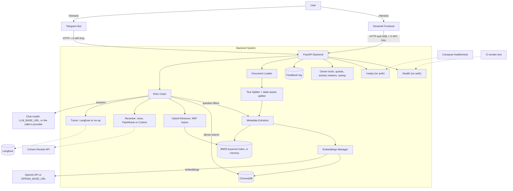

# 📄 Multi-language RAG Document Assistant - Technical Documentation

A RAG (Retrieval-Augmented Generation) assistant that lets users query their own documents
(PDF, DOCX, Markdown, TXT) in multiple languages with source attribution.

## Key Features

- **Multi-document Support**: specialized loaders for PDF, DOCX and text files
  (`.txt`, `.md`, `.markdown`), with charset detection for legacy text encodings.
  DOCX table rows are read as well, cells joined with ` | ` (see
  [Supported formats](#supported-formats) for what that loses).
- **Intelligent Chunking**: overlapping chunks preserve context - 1000 characters with 200 characters of overlap by default, configurable via `CHUNK_SIZE` / `CHUNK_OVERLAP`.
- **Table-aware Chunking**: a Markdown or HTML table stays in one chunk when it fits and
  is otherwise split by rows with its header repeated on every piece
  (`TABLE_AWARE_CHUNKING`, on by default). See [Table-aware chunking](#table-aware-chunking).
- **Multilingual Support**: explicit prompt rules for English, Russian, Kazakh, French,
  German, Spanish, Chinese, and Japanese, plus an `Auto` mode that mirrors the question.
- **Hybrid Retrieval**: a BM25 keyword index beside the ChromaDB vector search, merged by
  Reciprocal Rank Fusion, so exact names, numbers and rare terms are found as well as
  paraphrases (`HYBRID_SEARCH_ENABLED`, on by default). See
  [Hybrid search (dense + BM25)](#hybrid-search-dense--bm25).
- **Metadata Filtering**: company, year, quarter and document-type tags narrow retrieval,
  widening to all of the asker's documents when nothing matches
  (`METADATA_FILTERING_ENABLED`, on by default). The rules are built for financial
  filings: turn it off for a general document collection. See
  [Metadata filtering](#metadata-filtering).
- **Optional Reranking**: FlashRank (local; install the `flashrank` package first) or
  Cohere Rerank re-scores the candidates before the cut to `TOP_K_RESULTS`, for the whole
  deployment (`RERANKER_ENABLED`, `RERANKER_PROVIDER`) or for one request
  (`X-Reranker-*` headers). Off by default. See [Reranking](#reranking).
- **Any OpenAI-compatible Model**: embeddings come from OpenAI or `OPENAI_BASE_URL`;
  answers come from the same endpoint, from a separate one (`LLM_BASE_URL`, with a
  DeepSeek switch), or from the caller's own key and provider. See
  [The server's own model endpoint](#the-servers-own-model-endpoint) and
  [Your own key and model](#your-own-key-and-model).
- **Source Attribution**: answers ship with a separate list of source filenames and
  200-character previews. Inline citation markers are stripped from the answer text.
  A source also carries the document's metadata tags and, when a reranker scored it,
  its relevance score.
- **Conversations**: follow-ups are rewritten into standalone questions before retrieval
  (`MAX_HISTORY_TURNS`). See [Follow-up questions](#follow-up-questions).
- **Web UI**: Streamlit, responsive for desktop and mobile. Answers stream in as they
  are written ([Streaming](#streaming)), and sidebar panels set the caller's own key and
  model, a reranker and a metadata filter.
- **API**: FastAPI backend, guarded by one shared-secret header, with a streaming
  (Server-Sent Events) variant of the question endpoint, a request id on every
  response and log line, and separate liveness and readiness probes.
- **Telegram Bot**: uploads, questions with follow-ups, ratings and answering on the
  user's own key (`/model`) from a chat. Run it with `python -m clients.telegram_bot`.
- **Tenant Separation**: a `user_id` on every chunk keeps document sets apart. See
  [Tenant separation and the trust model](#tenant-separation-and-the-trust-model) for
  what this does and does not guarantee.
- **Document Management**: per-owner content deduplication, a listing with quota usage,
  single-document delete, and replacement of an earlier revision uploaded under the
  same file name.
- **Answer Feedback**: thumbs up or down under every answer in both clients, stored for
  review and turned into golden-set work by `python -m evaluation.from_feedback`. See
  [Answer feedback](#answer-feedback).
- **Quotas, Sweep, Backup**: per-owner document and byte limits, an idle-namespace sweep
  for abandoned web sessions (`python -m scripts.sweep`), and `python -m scripts.backup` /
  `python -m scripts.restore` with a verified manifest. See
  [Quotas and retention](#quotas-and-retention) and [Backup and restore](#backup-and-restore).
- **Observability**: request ids in responses and logs, `/ready` for orchestrators, and
  optional Langfuse tracing of each question's retrieval, reranking and generation, with
  ratings recorded as scores. See [Observability](#observability) and
  [Tracing with Langfuse](#tracing-with-langfuse).
- **Evaluation and Benchmarks**: offline retrieval metrics in the test suite, a live
  harness (`python -m evaluation.run_eval`), and Langfuse experiments over the golden set
  or public benchmarks. See [Measuring retrieval](#measuring-retrieval) and
  [Benchmarks and Langfuse experiments](#benchmarks-and-langfuse-experiments).

Verified defects, with workarounds, are summarised under [Known issues](#known-issues).

## System Architecture



An upload is parsed, split, tagged, embedded into ChromaDB and added to the in-memory
BM25 index, all under the owner's upload lock. A question is condensed when it carries
`history`, turned into a metadata filter, searched densely in ChromaDB and, with hybrid
search on, fused with the owner's BM25 hits; the candidates are reranked when a reranker
is active, cut to `TOP_K_RESULTS` and sent with the language rule to the chat model. The
Compose healthcheck probes `/ready`; only CI's smoke test uses `/health`.

### Components

1.  **Frontend (`frontend/`)**:
    -   Built with Streamlit.
    -   Handles file uploads and the question/answer interface.
    -   Talks to the backend over HTTP; answers are streamed from `POST /query/stream`
        as Server-Sent Events.
    -   Each browser session gets its own `web-<uuid>` namespace, and sidebar panels
        set the caller's own key and model, a reranker and a metadata filter.

2.  **Clients (`clients/`)**:
    -   `backend.py`: configuration (`BACKEND_URL`, `BACKEND_API_KEY`, `MAX_FILE_SIZE`,
        `FEEDBACK_ENABLED`, read from the environment) and the error wording both
        clients share, plus the header names, provider table, languages and quota line
        they import from the backend.
        They used to keep their own diverging copies of it.
    -   `telegram_bot.py`: the Telegram bot, built with `python-telegram-bot`.
        Supports document uploads (PDF/DOCX/Markdown/TXT), questions with follow-ups
        (sent to `POST /query`, not streamed), ratings and `/model` for the user's own
        key, and keeps the language, history and key in per-user memory only. Run it with
        `python -m clients.telegram_bot`.
    -   The bot lived in `telegram/` until Stage 3. That name collides with the
        installed `python-telegram-bot` package - harmless only because the
        directory had no `__init__.py`, and already enough to make two ruff
        versions sort its imports differently.

3.  **Backend (`app/`)**:
    -   **API (`main.py`)**: the routes in the API Reference below - `/health` and
        `/ready` (unauthenticated), `/upload`, `/query`, `/query/stream`,
        `GET /documents`, `DELETE /documents/{file_hash}`, `/clear`, `/feedback` and
        `/maintenance/sweep` - plus the owner locks and quota checks. Every route except
        `/health` is a plain `def`, so FastAPI runs its blocking ChromaDB, disk and model
        calls in a threadpool.
        `create_app()` is an application factory; components are built once during
        `lifespan` startup and stored on `app.state`.
    -   **Configuration (`config.py`)**: a single pydantic-settings `Settings` class is the
        one source of truth. The lifespan passes its values to every backend component
        explicitly; `RAGChain` keeps environment fallbacks only for direct construction.
        The clients load `.env` into the environment and read it themselves, while the
        backup and restore scripts read only the environment, so on the host they ignore
        `.env` (see KNOWN_ISSUES.md, section
        [Operations: backup, restore and sweep](KNOWN_ISSUES.md#operations-backup-restore-and-sweep)).
    -   **Document Loader (`rag/document_loader.py`)**: parses PDF, DOCX, TXT and
        Markdown into documents with basic metadata (type, page, encoding);
        `SUPPORTED_EXTENSIONS` is the one list of formats. Company, year, quarter and
        document type come from `rag/metadata_extractor.py`, called by the upload
        handler (see [Metadata filtering](#metadata-filtering)).
    -   **Text Splitter (`rag/text_splitter.py`)**: recursive splitting on paragraph,
        line, sentence and word boundaries. With `TABLE_AWARE_CHUNKING` on, documents go
        through `rag/table_splitter.py`, which keeps Markdown and HTML tables whole or
        splits them by rows with the header repeated, and sends prose to the same
        recursive splitter (see [Table-aware chunking](#table-aware-chunking)).
    -   **Embeddings Manager (`rag/embeddings.py`)**: OpenAI embeddings plus ChromaDB
        persistence, over a `chromadb.PersistentClient`. Its lookups and deletes are
        owner-scoped, it refuses a collection built by another embedding model, and it
        returns candidate vectors for MMR.
    -   **RAG Chain (`rag/chain.py`)**: `RAGChain._prepare`, shared by `ask` and
        `ask_stream`, condenses a follow-up, builds the metadata filter (falling back to
        all of the owner's documents when it matches nothing), retrieves - dense with
        `RELEVANCE_THRESHOLD` or MMR, plus BM25 fusion - reranks and builds the prompt
        with the language rule; `ask` and `ask_stream` then strip citation markers.
    -   **Retrieval helpers**: `rag/bm25.py` (in-memory Okapi BM25 index, one per
        process, searched per owner), `rag/hybrid.py` (RRF fusion of dense and BM25
        hits), `rag/reranker.py` (none, FlashRank or Cohere), `rag/metadata_extractor.py`
        (company, year, quarter and doc_type for uploads and questions, and the ChromaDB
        filter built from them) and `rag/languages.py` (the language table the prompt
        and both clients share).
    -   **Around the pipeline**: `byok.py` (the caller's own key, model and provider,
        and the `PROVIDERS` table), `tracing.py` (Langfuse or a no-op tracer),
        `observability.py` (request ids, the access log, readiness), `storage.py` (an
        owner's files, and wiping a namespace), `activity.py` (last-seen markers),
        `sweep.py` (the idle-namespace sweep), `feedback.py` (the ratings log),
        `backup.py` (snapshot and restore), `humanize.py` (sizes and the quota line) and
        `models/schemas.py` (request and response models).

4.  **Operator tooling and evaluation**:
    -   `scripts/` (shipped in the image): `backup.py`, `restore.py` and `sweep.py` for
        operators, plus `download_benchmarks.py` and `upload_to_langfuse.py` for the
        Langfuse benchmarks.
    -   `evaluation/` (not shipped): the retrieval metrics and golden set the test suite
        uses, `run_eval.py`, `from_feedback.py`, `langfuse_eval.py` and
        `eval_sberquad_failures.py`.

## Installation & Setup

### Prerequisites

- Python 3.10 - the version used by the Docker image, CI, the ruff target and the
  lock files.
- An OpenAI API key: embeddings always use it, even when answers come from another
  endpoint (`LLM_BASE_URL`) or from a caller's own key.
- A Telegram bot token (only if you run the bot).

### Steps (Manual)

1.  **Clone the repository**
    ```bash
    git clone <repository-url>
    cd Multi-language-RAG-Document-Assistant
    ```

2.  **Create a Python 3.10 virtual environment and install the dependencies**

    Linux / macOS:
    ```bash
    python3.10 -m venv .venv
    . .venv/bin/activate
    pip install -r requirements.txt -r requirements-dev.txt
    ```
    On Linux, `pip install --require-hashes -r requirements-dev.lock` instead installs
    exactly the set CI tests with (the runtime set plus pytest and ruff).

    Windows (PowerShell), with [uv](https://docs.astral.sh/uv/), which also fetches
    Python 3.10 if it is missing:
    ```powershell
    uv venv --python 3.10 .venv
    .venv\Scripts\activate
    uv pip install -r requirements.txt -r requirements-dev.txt
    ```
    The lock files do not install on Windows - see
    [Dependencies and the lock files](#dependencies-and-the-lock-files).

    WSL: either call that Windows venv from the checkout as
    `.venv/Scripts/python.exe -m <module>` (Linux environment variables reach it only
    when listed in `WSLENV`, and `git` may exist only as `git.exe`), or - more robust,
    and the only option where Windows application control (Device Guard / WDAC) stops
    that interpreter with "Invalid argument" - use a Linux venv inside WSL, outside
    the checkout, which gets exactly CI's set because the lock is Linux-native:
    ```bash
    uv venv --python 3.10 ~/.venvs/<name>
    uv pip install --python ~/.venvs/<name>/bin/python --require-hashes -r requirements-dev.lock
    ~/.venvs/<name>/bin/python -m pytest -q    # from the repository root
    ```

3.  **Configure the environment**

    Copy `.env.template` to `.env` (`cp .env.template .env`; `copy` on Windows) and
    fill it in:
    ```env
    OPENAI_API_KEY=sk-...
    # Shared secret every client sends as X-API-Key. Use a long random ASCII
    # string. Empty disables authentication (development only).
    BACKEND_API_KEY=<long-random-string>
    TELEGRAM_BOT_TOKEN=...        # only needed for the bot
    MODEL_NAME=gpt-4o-mini
    TEMPERATURE=0
    ```
    `OPENAI_API_KEY` has no default: without it the process aborts at startup with a
    pydantic `ValidationError`. Every other setting is listed in `.env.template` and
    in the [Configuration](#configuration) table. The tests need neither this file
    nor a key.

### Run locally

```bash
uvicorn app.main:app --reload --port 8000      # backend
streamlit run frontend/streamlit_app.py        # web UI
python -m clients.telegram_bot                 # bot
```

Start each in its own terminal with the venv active, from the repository root: the
backend reads `.env` from the current directory and creates `data/` under it, and the
clients find the same `.env`. Run exactly one backend process (no `--workers`): it is
the only ChromaDB writer, and the per-owner upload locks and the keyword (BM25) index
live in its memory.

### Development

With the development requirements installed (step 2):

```bash
ruff check app frontend clients evaluation scripts tests   # lint exactly as CI
pytest -q                                                  # the whole offline suite
pytest tests/test_<area>.py -q                             # one module
```

The suite is **offline by construction**, and that is enforced rather than intended:
autouse fixtures in `tests/conftest.py` replace OpenAI embedding calls with
deterministic local vectors and make any connection to a non-loopback address raise
("The suite must stay offline"), and the `api` fixture swaps the chain's chat client
for `FakeChatClient`. No API key is needed: the same file strips every `Settings`
variable from the process environment and sets `OPENAI_API_KEY=test-key-not-real`
itself, replacing any real key you exported.

Run pytest from the repository root, where `pyproject.toml` sets
`testpaths = ["tests"]`, so a bare `pytest` collects only that directory. Move a
local `.env` aside first: the web UI and bot tests load it into the test process,
which can change results depending on test order (see
KNOWN_ISSUES.md, section [Development and tests](KNOWN_ISSUES.md#development-and-tests)).
The full suite takes well under a minute on Linux and a few minutes on Windows. From
WSL, run it with whichever venv step 2 gave you, for example
`~/.venvs/<name>/bin/python -m pytest -q`.

### Dependencies and the lock files

`requirements.txt` and `requirements-dev.txt` are the **input specs** - they pin
the direct dependencies only. `requirements.lock` and `requirements-dev.lock` are
the **fully resolved** sets: every transitive package pinned, with SHA-256 hashes.

Why both: pinning only the direct dependencies left ~130 transitive ones
floating, and that is exactly how an incompatible `posthog` release started
logging an error on every startup. The Docker image and CI install from the
locks, so the Python package set is reproducible and `pip` refuses any artifact whose
hash does not match. Only that set: the base image (`python:3.10-slim`, pulled by tag)
and the apt packages the `Dockerfile` installs are not pinned.

The locks are resolved **for linux / CPython 3.10** - the image and CI. What is
Linux-specific is the resolution, not the hashes (each pin lists every file published
for that version): without environment markers the lock pins `uvloop`, which does not
support Windows, and leaves out Windows-only dependencies such as `colorama`, so it
cannot install there. On Windows or macOS, install from `requirements.txt` and
`requirements-dev.txt` instead; on Linux, WSL included, `requirements-dev.lock` gives
exactly CI's environment.

To change a dependency: edit the input spec, then regenerate **both** locks and
commit them together. Use the uv version CI pins (`UV_VERSION` in
`.github/workflows/ci.yml`), so a uv release cannot change how the lock resolves. The
commands work from any OS, because the target platform and Python version are explicit.

```bash
pip install uv==0.12.5

uv pip compile requirements.txt \
  --python-platform linux --python-version 3.10 \
  --generate-hashes --no-strip-extras \
  --output-file requirements.lock

uv pip compile requirements.txt requirements-dev.txt \
  --python-platform linux --python-version 3.10 \
  --generate-hashes --no-strip-extras \
  --output-file requirements-dev.lock
```

Compiling *into* the existing files is deliberate: uv reads them as version
preferences, so a new upstream release does not silently move an unrelated pin.
A direct requirement added or changed without regenerating fails
`tests/test_lockfile.py` locally. The `lock` job in CI recompiles both files and fails
on any diff, which also catches what the local tests cannot: a removed requirement or
a hand-edited pin.

`--no-strip-extras` is not optional. uv strips extras by default, which records
`uvicorn==0.29.0` instead of `uvicorn[standard]==0.29.0`. chromadb then asks pip
for `uvicorn[standard]`, pip treats the extra-decorated name as a separate
unpinned requirement, and `--require-hashes` refuses the whole file. The Docker
build is what caught this; no local check could.

## Docker Deployment

`docker compose` automatically merges `docker-compose.override.yml` on top of
`docker-compose.yml`, so the two modes are:

```bash
# Development - bind-mounts the working tree, runs the API with --reload
docker compose up --build

# Production - code baked into the image, detached, no override
docker compose -f docker-compose.yml up -d --build
```

This starts:
- **Backend API**: `http://127.0.0.1:8000` - published on the **loopback interface only**
  (`127.0.0.1:8000:8000`). Other hosts reach it only through the frontend/bot on the
  internal `rag_net` network, or through a reverse proxy you add yourself.
- **Streamlit Frontend**: `http://localhost:8501` - published on all interfaces, with no
  login of its own while it holds the shared secret. On an untrusted network, put it
  behind an authenticating reverse proxy.
- **Telegram Bot**: connects to Telegram over outbound polling.

The frontend and bot wait for the backend's `depends_on: service_healthy` gate, which is
driven by the `/ready` probe: a Python `urllib` request to `http://localhost:8000/ready`
every 15 s (5 retries, after a 15 s start period), so they start only once startup has
finished and the vector store answers. `/health` answers whenever the process answers
at all; the CI smoke test probes that one instead. Both receive
`BACKEND_URL=http://backend:8000` from the `environment:` block, which takes precedence
over any `BACKEND_URL` in `.env`; every other variable arrives via `env_file: .env`.

The `bot` service requires a valid `TELEGRAM_BOT_TOKEN` - without one the container exits
and restarts continuously. To run without it: `docker compose up backend frontend`.

Uploads, the vector database and the collected ratings live in the named volumes
`data_uploads`, `data_chroma` and `data_feedback`, mounted only into the backend at
`/app/data/uploads`, `/app/data/chroma_db` and `/app/data/feedback`. They survive
`docker compose down` (`down -v` discards them); [Backup and restore](#backup-and-restore)
covers copying them. One unconfirmed risk: the image creates, and hands to `appuser`,
only the first two mount points, so on a fresh deployment the feedback volume may be
owned by root and every rating answer 503 "Feedback storage unavailable". If that
happens, run
`docker compose run --rm -u root backend chown appuser:appuser /app/data/feedback`
once, or set `FEEDBACK_ENABLED=false`; see KNOWN_ISSUES.md, section
[Operations: backup, restore and sweep](KNOWN_ISSUES.md#operations-backup-restore-and-sweep).

In development the override bind-mounts the working tree into all three services
(`.:/app`) and reloads the backend on changes under `app/` only (`--reload-dir app`);
the data still lives in the named volumes.

What reaches the image is decided by `.dockerignore`: it leaves out `.env`, `tests/`,
`evaluation/`, the root-level Markdown files, `.claude/` (agent skills, never read at
run time; the `*.md` pattern only matches files in the build-context root), the README
GIFs under `app/docs/assets/`, local virtualenvs and caches, and the contents of
`data/chroma_db/`, `data/uploads/`, `data/feedback/` and `data/backups/`. `scripts/`
ships, so backup, restore and the sweep run in a container; `evaluation/` does not, so
its tools run from a checkout. `data/benchmarks/` (written by
`scripts/download_benchmarks.py`) is not excluded: delete it before building, or the
downloaded files are copied into the image.

### Local Langfuse (optional)

`docker-compose.langfuse.yml` is a separate stack that self-hosts Langfuse 2 for tracing
and the benchmark experiments: `langfuse/langfuse:2` with a `postgres:16-alpine`
database (volume `langfuse_postgres_data`) on its own `langfuse_net` network.

```bash
docker compose -f docker-compose.langfuse.yml up -d     # UI on http://localhost:3000
```

It is meant for a development machine: it publishes port 3000 on all interfaces and
commits fixed secrets. How to point the backend at it, and what to change before anyone
else can reach it, is in [A local Langfuse](#a-local-langfuse).

## Usage

### 1. Backend API
Interactive docs at `http://localhost:8000/docs`. When `BACKEND_API_KEY` is set, every
endpoint except `GET /health` and `GET /ready` requires the `X-API-Key` header;
FastAPI's `/docs`, `/redoc` and `/openapi.json` are served without it. See the API
Reference below.

### 2. Streamlit Web Interface
Open `http://localhost:8501`. Upload in the sidebar, ask in the main pane.

- Each browser session gets its own `web-<uuid>` namespace, so reloading the page starts
  an empty one (see
  [Tenant separation and the trust model](#tenant-separation-and-the-trust-model)).
- Several files can be uploaded at once; oversized and empty files are refused before
  they are sent. **📚 Your documents** lists what the backend holds for this session,
  with a delete button per document, and **🗑️ Clear all documents** removes all of it.
- **⚙️ Settings** picks the answer language, and the **Limits** box shows the per-file
  limit and the quota usage reported by `GET /documents`.
- **🔑 Answer on my own API key** takes a key, a provider and a model (see
  [Your own key and model](#your-own-key-and-model)).
- **🎯 Cross-Encoder Reranker** picks `flashrank` or `cohere` (with a Cohere key and
  model) for this session's questions; `none` sends no header, so the deployment's own
  setting applies. `flashrank` works only where the backend has the package installed.
- **🏷️ Metadata Filter** restricts questions to a company, one year and a document type.
  Type the company exactly as it appears in the source tags (`WALMART`, not a ticker or
  "Walmart Inc"): a filter that matches nothing is dropped without notice.
- The chat box stays disabled until something is indexed. Answers stream in, with a
  sources expander (preview, metadata tags, relevance score after reranking) and 👍/👎
  buttons when `FEEDBACK_ENABLED` is on. If an answer comes back empty or is cut short
  before any text, every later question in that tab fails until you clear the documents
  or reload the page (see KNOWN_ISSUES.md, section [Web UI](KNOWN_ISSUES.md#web-ui)).

### 3. Telegram Bot
1. Send `/start` and pick an answer language from the keyboard; `/start` also resets
   the conversation.
2. Attach a document (PDF, DOCX, Markdown or TXT). Telegram lets a bot download files of
   up to 20 MB, so larger ones are refused before they reach the backend.
3. Send any plain text message to ask a question. Follow-ups use the last six
   exchanges; a long answer arrives in several messages, then the source file names,
   with 👍/👎 under the last one when ratings are enabled.
4. `/documents` lists what is indexed, with the quota usage; `/clear` removes all of it;
   `/help` shows usage.
5. `/model <model> <your api key>` or `/model <provider> <model> <your api key>` answers
   on your own key, `/model` shows what is set and `/model reset` forgets it (see
   [Your own key and model](#your-own-key-and-model)). Always name the model:
   `/model <key>` alone is refused without deleting the message that holds the key,
   and other argument orders misfire. These and the bot's other known problems (a long
   `/documents` list, an empty answer) are in KNOWN_ISSUES.md, section
   [Telegram bot](KNOWN_ISSUES.md#telegram-bot).

## API Reference

**Authentication.** Every endpoint below except `GET /health` and `GET /ready` requires
the header `X-API-Key: <BACKEND_API_KEY>` and answers `401`
`{"detail": "Invalid or missing API key"}` otherwise. If `BACKEND_API_KEY` is empty
the check is skipped entirely - development only, and a warning is logged at startup,
as it is when the key is still the `.env.template` placeholder. FastAPI's generated
`/docs`, `/redoc` and `/openapi.json` are served without a key too: they describe the
API, not anyone's data.

`user_id` is **required** by every route that touches documents and must match
`^[A-Za-z0-9_-]{1,64}$`; anything else is rejected with `422`. It is a query parameter on
`/upload`, `/clear`, `GET /documents` and `DELETE /documents/{file_hash}`, and a JSON
body field on `/query`, `/query/stream` and `/feedback`; `/health`, `/ready` and
`/maintenance/sweep` take none. It doubles as a directory name and a metadata filter
value, which is why it is restricted.

**Every response** carries an `X-Request-ID` header. Send your own to have it
kept (`[A-Za-z0-9._-]`, up to 64 characters); anything else is replaced. See
Observability below. With Langfuse tracing on, a question's request id is also its
trace id, so questions that reuse an id end up in one trace (see KNOWN_ISSUES.md,
section [Tracing and observability](KNOWN_ISSUES.md#tracing-and-observability)).

**Error bodies** are `{"detail": "<message>"}`, except a `422`, whose `detail` is
FastAPI's list of validation errors (`loc`, `msg`, `type`, ...), and an unhandled
`500`, which is `{"detail": "Internal server error", "request_id": "..."}`.

### `GET /health`
Liveness probe: the process is answering. **No authentication.**
-   **Response**: `{"status": "ok", "version": "0.2.0"}`
-   Says nothing about whether a query would work - use `/ready` for that.

### `GET /ready`
Readiness probe: whether the components a request needs are usable.
**No authentication** - an orchestrator's probe has no API key.
-   **Response (ready)**: `200` with
    `{"status": "ready", "checks": {"startup": "ok", "vector_store": "ok"}}`
-   **Response (not ready)**: `503` with the same shape and `"failed"` against
    the check that failed; before startup has finished only
    `{"startup": "failed"}` is reported. Never *why*: the endpoint is
    unauthenticated and an exception message can carry a filesystem path.
-   Used by the Compose healthcheck, so `depends_on: service_healthy` means
    "can serve" rather than "has a socket open".

### `POST /upload`
Uploads and indexes a document.
-   **Body**: `multipart/form-data` with `file` (`.pdf`, `.docx`, `.txt`, `.md`,
    `.markdown`). The list lives in `SUPPORTED_EXTENSIONS` in
    `app/rag/document_loader.py`, which the API gate and both clients read.
    The filename is reduced to a safe base name (anything but letters, digits, `_`,
    `.`, `-` and spaces becomes `_`, and the stem is cut to 150 bytes); that name is
    what `filename`, `source` and the stored file carry. The body is received and
    spooled to a temporary file before the key and the size are checked, so
    `MAX_FILE_SIZE` bounds memory, not bandwidth or temporary disk: cap request
    bodies at a reverse proxy.
-   **Query Parameters**: `user_id` (**required**, see above).
-   **Response (indexed)**:
    ```json
    {"message": "Document processed successfully", "filename": "report.pdf",
     "chunks": 15, "duplicate": false, "file_hash": "a1b2c3d4e5f60718",
     "replaced": false}
    ```
    `file_hash` is the handle the document endpoints below take.
-   **Response (duplicate)** - the same bytes were already indexed for this `user_id`
    (deduplicated by SHA-256 of the file content):
    ```json
    {"message": "Document already indexed (identical content)", "filename": "report.pdf",
     "chunks": 0, "duplicate": true, "file_hash": "a1b2c3d4e5f60718",
     "replaced": false}
    ```
-   **Revisions**: uploading a **different** file under a name this `user_id` already
    used replaces the earlier revision - its chunks and its stored file are removed and
    `replaced` comes back `true`. Both revisions used to stay indexed and answer the
    same question, with nothing telling the reader which sentence came from which.
-   **Matching rules**: deduplication looks at the content only. The same bytes under
    a new name are a duplicate - the response echoes the new name while the document
    keeps its first one - and new bytes for a name are a duplicate too, replacing
    nothing, when this owner already holds them under another name. A revision is
    matched on the exact sanitized filename, case included (`Report.pdf` and
    `report.pdf` are two documents). Because an identical re-upload is skipped,
    re-indexing after a `CHUNK_SIZE` change needs a delete and a fresh upload.
-   **Errors**:
    -   `400` - with one of these `detail` messages: `Invalid filename` (nothing usable
        left after sanitizing, or a dotfile); `Unsupported file type. Supported: PDF,
        DOCX, TXT, MD, MARKDOWN` (a legacy `.doc` gets this generic message too: re-save
        it as `.docx` or export it to PDF); `Uploaded file is empty`; `File too large.
        Maximum allowed size is 30 MB.` (the size follows `MAX_FILE_SIZE`); `Could not
        read the document. It may be corrupted or empty.`; `Document contains no
        extractable text`.
    -   `401` - bad or missing `X-API-Key`.
    -   `413` - this upload would take the owner past `MAX_DOCUMENTS_PER_USER` or
        `MAX_BYTES_PER_USER`. The detail carries the numbers and the remedy. An
        identical re-upload still succeeds at the limit (it adds nothing), and a new
        revision of an existing filename is judged after the old revision is
        discounted (it replaces it). See Quotas and retention.
    -   `422` - missing or malformed `user_id`, or no `file` part (an empty filename
        counts as none).
    -   `503` - `Vector store unavailable` when the dedup or quota lookup or the write
        fails, which includes the embedding call failing on the deployment's key;
        `Storage unavailable` when the file cannot be written to disk. A document too
        big for one ChromaDB write (about 4.5 MB of extracted text at the default
        settings) currently fails here after its embeddings are paid for: split it
        (see KNOWN_ISSUES.md, section [Document ingestion](KNOWN_ISSUES.md#document-ingestion)).

### `POST /query`
Asks a question against the indexed documents.
-   **Headers** (optional, besides `X-API-Key`):
    -   `X-Model-Key`, `X-Model`, `X-Model-Provider` - answer on the caller's own key,
        with the model and provider they name; a model or provider without a key is
        a `400`. See [Your own key and model](#your-own-key-and-model).
    -   `X-Reranker-Provider` (`none`, `flashrank` or `cohere`), `X-Reranker-Key`,
        `X-Reranker-Model` - rerank this request's candidates with that provider;
        `none` turns reranking off for the request, an unknown provider is a `400`,
        and `cohere` needs `X-Reranker-Key` unless `RERANKER_API_KEY` is set. The
        header applies even when `RERANKER_ENABLED` is off and is not limited by
        `ALLOWED_MODEL_PROVIDERS`; with `cohere` and no key the operator's
        `RERANKER_API_KEY` pays, so leave that setting empty unless every key holder
        may spend it (see KNOWN_ISSUES.md, section
        [Models, keys and reranking](KNOWN_ISSUES.md#models-keys-and-reranking),
        which also covers `flashrank` not being installed).
-   **Body**: `{"question": "...", "language": "Auto", "user_id": "...",
    "history": [{"question": "...", "answer": "..."}],
    "metadata_filter": {"company": "WALMART", "year": 2020}}`.
    `question` must be 1-4000 characters; `history` is optional, holds at most
    20 turns (each answer 1-8000 characters, so an empty answer is a `422`) and is what
    makes a follow-up work (see
    [Follow-up questions](#follow-up-questions)); `language` is one of the values in
    [Supported languages](#supported-languages), defaulting to `Auto`. An unrecognised
    value falls back to `Auto` behaviour rather than failing.
-   **`metadata_filter`** (optional) narrows retrieval to chunks whose metadata match:
    keys `company`, `year`, `quarter` and `doc_type`, each a value (`"WALMART"`,
    `2020`, `"Q3"`, `"10-K"`) or a ChromaDB operator such as `{"$in": [2019, 2020]}`.
    It is merged over the filter extracted from the question (extraction needs
    `METADATA_FILTERING_ENABLED`; an explicit filter applies either way), a `null` value
    cancels an extracted key, a `user_id` key is ignored, and every clause is ANDed with
    the caller's `user_id`, so it can only narrow the caller's own documents. When the
    filtered search finds nothing, retrieval falls back to all of the caller's
    documents without saying so; a value ChromaDB rejects is a `503`, not a `422`; and
    any active filter currently switches off the BM25 half of hybrid search (see
    KNOWN_ISSUES.md, section [Retrieval and search](KNOWN_ISSUES.md#retrieval-and-search),
    which also covers `MMR_LAMBDA` below 1.0 turning every filtered question into a
    `503`). [Metadata filtering](#metadata-filtering) describes what is detected and
    how.
-   **Response**:
    ```json
    {"answer": "...",
     "sources": [{"id": 1, "source": "report.pdf", "preview": "first 200 chars…",
                  "rerank_score": null,
                  "metadata": {"company": "WALMART", "year": 2020, "doc_type": "10-K"}}],
     "model": "gpt-4o-mini"}
    ```
    Sources are deduplicated by filename and numbered from 1. `rerank_score` is set
    when a reranker scored the chunk, and `metadata` holds whichever of `company`,
    `year`, `quarter` and `doc_type` the document was tagged with; either is `null`
    otherwise. `model` is the model the request asked for: `X-Model` when sent,
    otherwise the deployment's. When nothing is retrieved the call still succeeds with
    `"No relevant information found."`, an empty `sources` list and `"model": null` -
    no answer is generated, though a follow-up's condensing call has already been made.
-   **Errors**:
    -   `400` - a malformed `X-Model-Key` or `X-Model`, a model or provider without a
        key, an unknown or disallowed provider, a bad `X-Reranker-*` header, or the
        caller's own provider refused their key, model, quota or balance (see
        [Your own key and model](#your-own-key-and-model)).
    -   `401` - bad or missing `X-API-Key`.
    -   `422` - validation (question length, `user_id` shape, `history` size or an
        empty turn, a `metadata_filter` that is not an object).
    -   `429` - the deployment's model provider rate limited us. Retryable; a
        `Retry-After` header says how long to wait.
    -   `504` - the model, or the question's embedding, did not answer within
        `OPENAI_TIMEOUT`. Retryable.
    -   `503` - retrieval or generation failed for another reason, including a
        `metadata_filter` value ChromaDB rejects.

### `POST /query/stream`
The same question, answered as it is generated. `/query` is unchanged; this is
an addition.

-   **Body** and **headers**: identical to `/query`.
-   **Response**: `text/event-stream`. Each event is a `data:` line holding one
    JSON object:
    ```
    data: {"type": "sources", "sources": [{"id": 1, "source": "report.pdf", "preview": "..."}]}
    data: {"type": "token", "text": "Revenue "}
    data: {"type": "token", "text": "grew "}
    data: {"type": "done"}
    ```
    Sources arrive **first**, before any token: they are known as soon as
    retrieval finishes. A source here leaves out `rerank_score` and `metadata` when
    they are unset rather than sending `null`. Concatenating every `token` gives the
    answer with citation markers already stripped; it is a separate generation, so it
    need not match a `/query` answer word for word. When nothing is retrieved the
    stream is a `sources` event with an empty list, one `token` carrying
    `"No relevant information found."` and `done`. No event names the model, and
    streamed answers record no token usage in the log or in Langfuse (see
    KNOWN_ISSUES.md, section
    [Tracing and observability](KNOWN_ISSUES.md#tracing-and-observability)).
-   **Errors**: retrieval and opening the model's stream both happen before the
    first byte, so their failures are ordinary status codes - `400`, `401`, `422`,
    `429`, `504`, `503`, exactly as on `/query`. A follow-up's condensing call never
    fails the request: an error there is logged and the question is searched as
    asked. A failure *after* the response has started cannot change a status line
    that is already sent, so it arrives as a final
    `{"type": "error", "detail": "The answer was cut short."}` event.
-   The response sets `Cache-Control: no-cache` and `X-Accel-Buffering: no`;
    a proxy that buffers the body defeats the entire feature.

### `GET /documents`
Lists what this `user_id` has indexed, one entry per document rather than per chunk.
-   **Query Parameters**: `user_id` (**required**).
-   **Response**:
    ```json
    {"documents": [{"file_hash": "a1b2c3d4e5f60718", "source": "report.pdf",
                    "chunks": 15, "type": "pdf", "pages": 4}],
     "total_chunks": 15,
     "quota": {"documents": 1, "max_documents": 200,
               "bytes": 348160, "max_bytes": 1073741824}}
    ```
    Sorted by filename, case-insensitively. `type` is the file's extension (`pdf`,
    `docx`, `txt`, `md` or `markdown`), and `pages` is set for PDFs only (`null` for
    DOCX, TXT and Markdown).
    `quota` is where this owner stands against the per-owner limits, so a limit is
    visible before it is hit; a max of `0` means that limit is off. `bytes` counts
    only files that back a listed document.
-   **Errors**: `401`, `422`, `503` (vector store unavailable).

### `DELETE /documents/{file_hash}`
Removes one document: its chunks, its entries in the BM25 keyword index **and** the
raw file behind it.
-   **Path Parameters**: `file_hash` - 16 lowercase hex characters, as returned by
    `/upload` and `GET /documents`.
-   **Query Parameters**: `user_id` (**required**).
-   **Response**:
    ```json
    {"message": "Document deleted", "file_hash": "a1b2c3d4e5f60718", "chunks_removed": 15}
    ```
-   Scoped to the owner: the identical file held by another `user_id` is untouched,
    and deleting a hash you do not own is a `404`, not a silent success.
-   **Errors**: `401`, `404` (no such document for this owner), `422` (malformed hash
    or `user_id`), `503`.

### `POST /feedback`
Records one rating of one answer. Requires `FEEDBACK_ENABLED`.
-   **Body**: `{"rating": "up"|"down", "user_id": "...", "question": "...",
    "answer": "...", "sources": ["policy.docx"], "request_id": "...",
    "comment": "...", "language": "...", "client": "web"}`. Only `rating`,
    `user_id` and `question` are required; `request_id` is the `X-Request-ID` of
    the request being rated. Limits: `question` 1-4000 characters, `answer` up to 8000,
    at most 20 `sources`, `request_id` in the `X-Request-ID` alphabet (up to 64),
    `comment` up to 1000, `language` up to 32, `client` lowercase letters only, up
    to 16.
-   **Langfuse**: with tracing on, a stored rating also becomes a `user_feedback`
    score on the trace named by `request_id` (see
    [Ratings become scores](#ratings-become-scores)). Always send `request_id`:
    without it the score lands on the most recent trace the backend created, which
    may be another user's (see KNOWN_ISSUES.md, section
    [Tracing and observability](KNOWN_ISSUES.md#tracing-and-observability)).
-   **Response**: `{"message": "Thanks - recorded."}`
-   **Errors**: `401`, `404` (collection disabled), `422`,
    `507` (the file is at `FEEDBACK_MAX_BYTES`), `503` (the write failed).
-   The client sends the exchange rather than the server remembering it, so the
    API stays stateless and a replica that did not serve the query can still
    take the rating.

### `POST /maintenance/sweep`
Finds namespaces nobody has touched in `idle_days` and, when asked twice, removes
them. Runs inside the backend because ChromaDB must have a single writer - the same
reason backup and restore insist the backend is stopped. Meant to be called by
`python -m scripts.sweep`.
-   **Query Parameters**: `idle_days` (**required**, `1`-`3650`), `prefix`
    (**required**, `[A-Za-z0-9_-]` up to 64; the empty string means every owner, and
    has to be written into the request on purpose), `apply` (default `false` = dry
    run), `force` (default `false`).
-   **Response**: `200` with
    ```json
    {"idle_days": 30, "prefix": "web-", "dry_run": true,
     "cutoff": "2026-07-27T12:00:00+00:00", "newest_seen": "2026-08-26T09:14:02+00:00",
     "candidates": [{"user_id": "web-3f1c...", "documents": 2, "bytes": 51200,
                     "last_seen": "2026-06-30T08:00:00+00:00"}],
     "empty": [], "unknown": [], "foreign": ["tmp restore"],
     "orphans": [{"user_id": "12345", "files": 1, "bytes": 4096, "in_scope": false}],
     "swept": [], "became_active": [], "failed": [], "orphans_removed": 0,
     "refused": null}
    ```
    Every owner **matching the prefix** is in exactly one of `candidates` (idle,
    with something to delete), `empty` (idle, only a marker or an empty directory
    left), `unknown` (nothing dates it - never swept) or not listed at all, which
    means it is active. `foreign` is
    names on disk that cannot be a `user_id` and are never acted on. `orphans` is
    stored files with no vectors behind them, per owner: reported for **every**
    owner, since they are most likely under the stable ids a `web-` prefix
    excludes, but removed on apply only for owners inside the prefix - `in_scope`
    says which. An operator who asked to sweep web sessions should not have files
    deleted elsewhere.
-   **Refusals**: with `apply=true` and no `force`, the sweep declines - `200`,
    `dry_run: true`, `refused` set to the reason, nothing deleted - when the
    prefix is empty, when `idle_days` is below 7, when activity writes have failed
    since startup, or when there is something to sweep but no owner at all has been
    seen inside the window (after a restore or a long stop that is stale data, not a
    mass departure).
-   **Errors**: `401`, `422`, `503` (vector store unavailable).
-   **Applying** removes each swept owner's vectors, files and activity marker under
    their owner lock, but not their entries in the in-memory BM25 index: until the
    backend restarts, the same `user_id` can still get answers citing the swept
    documents. Restart the backend after an applied sweep, or call `POST /clear` for
    each swept `user_id` (see KNOWN_ISSUES.md, section
    [Operations: backup, restore and sweep](KNOWN_ISSUES.md#operations-backup-restore-and-sweep)).

### `POST /clear`
Deletes the caller's documents: the vectors, their BM25 entries, the activity marker
**and** the raw uploaded files on disk, under the owner's upload lock. An owner with
nothing indexed gets the same `200`.
-   **Query Parameters**: `user_id` (**required**).
-   **Response**: `{"message": "Documents cleared successfully"}`
-   **Errors**: `401`, `422`, `500` (deletion failed).

## Your own key and model

A caller can answer on their own API key, with the model they choose:

```bash
curl -H "X-API-Key: $BACKEND_API_KEY" \
     -H "X-Model-Key: sk-your-own-key" \
     -H "X-Model: gpt-4o" \
     -H "Content-Type: application/json" \
     -d '{"question": "...", "user_id": "u1"}' \
     http://127.0.0.1:8000/query
```

Both `/query` and `/query/stream` take `X-Model-Key`, plus `X-Model` and
`X-Model-Provider` when wanted (see the table below). `POST /query` answers
with a `model` field naming the model the backend asked for, so a caller can
check that the header took effect rather than trust it: the deployment's own
model when no `X-Model` was sent, `null` when nothing was retrieved and no model
was called. The stream carries no such field.

The headers are checked before the question is touched, and every problem with
them is a `400` whose message never repeats the key: the key must be 8 to 256
letters, digits, `.`, `_` or `-` once surrounding spaces are trimmed (a cut-off
paste is the usual culprit), a model name 1 to 80 letters, digits, `.`, `_`,
`:`, `/` or `-`, and the provider one of the names below, in any case.

**Answers only; indexing stays on the deployment's key.** The vector store is
one ChromaDB collection bound to one embedding model - Chroma fixes the
dimension per collection, and `embeddings.py` refuses to open a collection built
by a different model, because vectors from two models are not comparable. So the
choice on offer is the answer model, which is the one a person can tell apart
anyway. An upload is embedded on the operator's key whatever headers it carries,
and so is every question, for the search. The caller's key pays only for
rewriting a follow-up into a standalone question and for the answer itself.

**The key is never stored.** It arrives in a header, is used for one request,
and the client holding it is closed when that request ends - including the
streaming case, where it is closed after the last token rather than when the
handler returns. Nothing writes it to disk and no cache is keyed on it: a
connection pool per key would be faster and would mean the secret outlives the
request that carried it. `user_id` is unauthenticated client input, so a stored
key would also be one that anyone holding the shared secret could spend. One
path currently misses the close: a streamed answer that times out before its first
event answers `504` and leaves the client to garbage collection rather than
closing it (see KNOWN_ISSUES.md, section
[Models, keys and reranking](KNOWN_ISSUES.md#models-keys-and-reranking)).

**A model or a provider may only be chosen together with a key** (`400`
otherwise). Without that rule, naming a model is a way to spend the operator's
money on a costlier one than they configured.

**The endpoint is chosen from a list, never supplied.** A caller names a
provider and the URL comes from a table the backend owns:

| `X-Model-Provider` | Endpoint | A bad key answers |
| --- | --- | --- |
| `openai` (default) | this deployment's `OPENAI_BASE_URL` (api.openai.com when empty), never `LLM_BASE_URL` | `401` |
| `anthropic` | `https://api.anthropic.com/v1/` | `401` |
| `gemini` | `https://generativelanguage.googleapis.com/v1beta/openai/` | `400` |
| `deepseek` | `https://api.deepseek.com/v1` | `401` |
| `kimi` | `https://api.moonshot.ai/v1` | `401` |
| `kimi-cn` | `https://api.moonshot.cn/v1` | `401` |

All of them answer OpenAI's chat completions protocol, which is why one client
library reaches every one; the endpoints and that last column were checked by
asking each provider with a deliberately invalid key. Letting a caller pass the
URL itself would make the backend fetch whatever it is handed, internal
addresses included - which is why this is a name and not an address, and why
`ALLOWED_MODEL_PROVIDERS` lets an operator narrow the list.

`ALLOWED_MODEL_PROVIDERS` is a comma-separated list of these names, trimmed and
case-insensitive; unknown names are ignored, so a list of nothing but unknown
names refuses every named provider. It is checked only when `X-Model-Provider`
is sent: a key with no provider is always accepted and goes to the `openai`
endpoint, even when `openai` is not on the list, and no setting turns callers'
keys off altogether. Both clients offer every name in the table, so a user can
pick one the deployment refuses; the `400` then lists the ones it offers.

`openai`, and a key sent without a provider, mean the deployment's
`OPENAI_BASE_URL`, so a deployment already pointed at a gateway (OpenRouter,
LiteLLM, vLLM, Azure) keeps working and its users can reach anything that
gateway offers. `LLM_BASE_URL` is never used for a caller's key: on a deployment
that answers through it (see
[The server's own model endpoint](#the-servers-own-model-endpoint)), callers
should name their provider, or their key goes to `OPENAI_BASE_URL` or
api.openai.com.

**There is no default model per provider.** Naming a provider without
`X-Model` sends the deployment's own model to it, which that provider will
normally not offer (a `400`), so send both. With `X-Model-Provider: deepseek`,
the aliases `deepseek-chat`, `deepseek-v4-flash`, `deepseek-v4.1-flash` and
`v4.1-flash` (in any case, with `_` read as `-`) are sent as `deepseek-flash`;
other names, and every name sent without that header, go through unchanged.

**When the provider refuses**, the caller hears about it rather than the
operator: `400` with what happened - a rejected key, a model their key cannot
reach, their own quota, an empty balance (DeepSeek answers `402`), or any other
status the provider chose. That last catch-all is not tidiness: providers
disagree about what a bad key is, and Gemini's `400` used to fall through to
"Query failed", which blamed the operator for the caller's typo. This is the one
place a `401` upstream is *not* an operator problem, and both clients hide
`401`/`403` behind "contact the operator", so it must not travel that path. The
provider's own wording is not passed through: it can carry account details and
says nothing the caller cannot work out. Without a caller's key, an upstream
failure keeps its old meaning - `429` with `Retry-After`, `504` on a timeout,
`503` otherwise. With one, any status the provider answers - its own outage
included - is that `400`, while a timeout is still `504` and an unreachable
provider still `503`.

**Reranker headers.** `X-Reranker-Provider` (`none`, `flashrank` or `cohere`),
with `X-Reranker-Key` and `X-Reranker-Model`, picks the reranker for one
question on either question endpoint; without it the other two are ignored, and
an unknown name is a `400`. These headers do not follow the rules above: they
need no `X-Model-Key`, they apply even with `RERANKER_ENABLED=false` (and `none`
turns the operator's reranker off for that question), `ALLOWED_MODEL_PROVIDERS`
does not cover them, and `cohere` without `X-Reranker-Key` spends the operator's
`RERANKER_API_KEY` on the Cohere model `X-Reranker-Model` names (else
`RERANKER_MODEL`, else `rerank-v3.5`; a `400` only when neither key exists).
Leave `RERANKER_API_KEY` empty unless every holder of the API key may spend it.
`flashrank` does nothing unless the `flashrank` package has been installed into
the backend's environment, which neither the requirements nor the image do (see
KNOWN_ISSUES.md, section
[Models, keys and reranking](KNOWN_ISSUES.md#models-keys-and-reranking)). What
reranking does is described in [Reranking](#reranking).

In the clients:

- **Streamlit**: "🔑 Answer on my own API key" in the sidebar, directly under
  the uploader - a password field, a provider picker and a model box. Folded
  away until it holds a key, so it costs nothing to anyone who does not want
  it, and open when it does, since that is what someone came back to change.
  All three live in session state, so they go when the tab does. The main pane
  says which model is answering, or where to set one: the section used to sit
  last in the sidebar, under a document list that grows with every upload, and
  was findable only by scrolling the whole panel. The picker lists every
  provider the backend knows, not only those `ALLOWED_MODEL_PROVIDERS` permits,
  and the model hint per provider is only a placeholder: an empty model box
  sends no `X-Model`, so a provider other than `openai` gets the deployment's
  model. Below it, "🎯 Cross-Encoder Reranker" sends the reranker headers: `none`
  sends nothing and leaves the operator's setting in charge, while `flashrank` or
  `cohere` sets `X-Reranker-Provider`, and `cohere` adds a key and a model box.
  Those values live in session state too.
- **Telegram**: `/model <model> <your api key>`, or
  `/model <provider> <model> <your api key>` to name a provider (recognised only
  in that three-word form); `/model` alone shows whether a key is held, the
  provider and the model, never the key itself, and lists every provider the
  backend knows (the deployment may allow fewer); `/model reset` forgets all
  three. The message carrying the key is deleted immediately - it would
  otherwise sit in the chat history on the device and on Telegram's servers -
  and if the bot cannot delete it (no permission in a group) it says so rather
  than leaving the user to assume it was handled. Other shapes are not handled
  safely yet: `/model <key>` alone gets the usage text and its message is not
  deleted, swapped arguments repeat the key in the bot's reply, and
  `/model <provider> <key>` sends the key to the deployment's default endpoint;
  delete whatever shows the key yourself and use the full form (see
  KNOWN_ISSUES.md, section [Telegram bot](KNOWN_ISSUES.md#telegram-bot)). The
  values are held in the bot's memory per Telegram user - in every chat that
  user shares with the bot, groups included - until `/model reset` or a
  restart. The bot asks through `POST /query` and sends no reranker headers.

### The server's own model endpoint

Without a caller's key the deployment answers on its own account, and two sets
of three settings decide where its calls go:

- **Embeddings** - every upload, and every question's search vector - use
  `OPENAI_API_KEY` at `OPENAI_BASE_URL` (api.openai.com when empty) with
  `EMBEDDING_MODEL`, whatever else is set. That is why `OPENAI_API_KEY` stays
  required, and why whatever `OPENAI_BASE_URL` points at must serve that
  embedding model.
- **Answers**, and the rewrite of follow-up questions, use `LLM_API_KEY` at
  `LLM_BASE_URL` with `MODEL_NAME`; each of the two falls back to its
  `OPENAI_` counterpart when empty. That split lets a deployment keep OpenAI
  embeddings and take answers from another OpenAI-compatible endpoint:

```bash
LLM_BASE_URL=https://api.deepseek.com
LLM_API_KEY=sk-your-deepseek-key
```

**The DeepSeek switch.** When the answer endpoint (`LLM_BASE_URL`, or
`OPENAI_BASE_URL` when that is empty) contains "deepseek", in any case, startup
replaces `MODEL_NAME=gpt-4o-mini`, the default, with `deepseek-flash`, and
rewrites a `MODEL_NAME` that is one of the DeepSeek aliases (`deepseek-chat`,
`deepseek-v4-flash`, `deepseek-v4.1-flash`, `v4.1-flash`, in any case) to
`deepseek-flash` too; any other name is sent as written. Only the URL is looked
at, so a gateway that serves DeepSeek models under another address is left
alone. Pointing `OPENAI_BASE_URL` itself at DeepSeek also triggers the switch,
but moves the embeddings there as well. The model in use shows in the `model`
field of `POST /query` and as `model=` in the backend's `chat completion` log
line.

**Callers' keys never use `LLM_BASE_URL` or `LLM_API_KEY`.** A caller's key goes
to the provider they name, or to `OPENAI_BASE_URL` (api.openai.com when empty)
when they name none or name `openai`, and without `X-Model` it is sent the
deployment's model - after the switch, `deepseek-flash` sent to OpenAI. Callers
of a deployment that answers through DeepSeek should therefore send
`X-Model-Provider: deepseek`.

**Shared transport settings.** `OPENAI_TIMEOUT` and `OPENAI_MAX_RETRIES` apply
to every one of these clients, callers' included, so a caller's key cannot make
the backend wait longer than the operator allows. All of them also ignore
`HTTP_PROXY` and `HTTPS_PROXY` on purpose (`trust_env=False`), so a stray proxy
variable cannot redirect API traffic; to go through a gateway, point the base
URL at it. The Langfuse SDK and the Cohere reranker do follow proxy variables.

## Quotas and retention

Until Stage 15 the only bound was `MAX_FILE_SIZE`, on one file. One `user_id` could
fill the volume the vector store lives on, and every upload was paid embedding calls
with no ceiling.

**Per-owner limits.** `MAX_DOCUMENTS_PER_USER` (200) and `MAX_BYTES_PER_USER` (1 GiB)
bound what one owner may hold. An upload that would cross either is refused with
`413` and a message naming the numbers and the remedy. They ship on - unlike
`RELEVANCE_THRESHOLD` and `MMR_LAMBDA`, which ship off - because of how they fail: a
wrong threshold silently drops relevant context, an exceeded quota is loud. `0`
disables a limit (unlike `MAX_FILE_SIZE`, where `0` is rejected). The check happens
after deduplication, so an identical re-upload succeeds at the limit, and a new
revision of an existing filename is judged with the old revision discounted. Bytes
are counted only for files that back a listed document; a file with no vectors
behind it is invisible in `/documents` and cannot be deleted through the API, so
counting it would present a limit there is no way to get under.

Both clients show the usage line from `GET /documents` (`3 of 200 documents, 12 KB
of 1 GB`; with a limit off, just the usage). The message names no setting - that
goes to the backend log at WARNING, where the person who can change it is reading.

Uploads from one owner are serialized in-process: the quota check is a read
followed by a write, and two uploads arriving together would both read "room for
one more". The lock is striped (64 stripes), because the web UI mints a new owner
per browser session and a lock per `user_id` would grow for as long as the process
lived. The guarantee is per process, which the single-writer ChromaDB constraint
already makes the only deployment shape. The lock is held through parsing and
embedding, so a slow upload also delays `/clear`, sweep removals and uploads of owners
that share its stripe; `DELETE /documents/{file_hash}` does not take it.

Quotas are keyed on `user_id`, which is unauthenticated client input. They protect
against accidents and runaway cost, not abuse: anyone holding the shared key can
pick another `user_id`.

**Activity.** Each owner has a marker file under `UPLOAD_DIR/.activity/`, touched by
a successful upload (a duplicate included), question (even from an owner with no
documents), listing (of a non-empty namespace), delete or rating. `last_seen` is the
newer of the marker and the owner's newest uploaded file, so an upload in flight
cannot be mistaken for idleness. Owners from before markers existed are seeded at
startup, so "idle" means "idle since the upgrade" - dating them by their newest
upload would be a lower bound on activity, and a lower bound can only make a live
owner look more idle than they are. Markers travel with backups; a restore dates them
all now, since restoring last month's snapshot would otherwise make everyone look a
month idle by construction.

**The sweep.** The web UI's `web-<uuid>` namespaces are orphaned the moment a tab
closes and can never be reached again - and since Stage 14 they are copied into
every backup. `python -m scripts.sweep` lists namespaces idle for 30+ days under the
`web-` prefix; `--apply` removes them. Telegram ids are digit-only, so that prefix
can never match a Telegram user; sweeping every tenant needs an explicit
`--prefix ""` and, on the backend, `force`. The script itself deletes nothing: it
asks the running backend's `POST /maintenance/sweep`, which does the work in the one
process allowed to write to ChromaDB. Unlike backup and restore it reads `.env` (for
`BACKEND_URL` and `BACKEND_API_KEY`), and it waits up to 600 s for the answer.

```bash
python -m scripts.sweep                          # dry run
python -m scripts.sweep --apply                  # remove idle web sessions
docker compose run --rm bot python -m scripts.sweep --apply
```

| Flag | Meaning |
| --- | --- |
| `--idle-days N` | untouched for this many days counts as idle (default `30`) |
| `--prefix P` | only owners whose id starts with this (default `web-`; `""` for every tenant) |
| `--apply` | remove what the dry run lists; without it nothing is deleted |
| `--force` | override the backend's own refusals (below) |
| `--url URL` | backend to ask (default `BACKEND_URL`, else `http://127.0.0.1:8000`) |
| `--api-key KEY` | `X-API-Key` to send (default `BACKEND_API_KEY`) |
| `--json` | print the backend's response as JSON instead of the report |

Exit status: `0` done, `1` the backend answered with an HTTP error or an owner could
not be removed, `2` the backend could not be reached, `3` apply was refused - so a
cron job can alert on anything but `0`.

In Compose the sweep runs from the `bot` service: it needs the backend up (unlike
backup and restore), and the bot carries `BACKEND_URL=http://backend:8000` and the
API key. A one-off `backend` container would ask `localhost` and find nobody.

Everything about the sweep is arranged around the one mistake it can make. Dry run
is the default. An owner nothing dates (vectors, but no upload directory and no
marker) is reported as unknown and never removed, not even with `--force`; remove one
deliberately with `POST /clear`. `apply` refuses on its own - and says why - without a
prefix, below 7 idle days, after any failed activity write since startup (a
per-process count: fix the volume, then restart the backend to clear it), and when
there is something to sweep but no owner at all has been seen inside the window.
Each deletion is logged before it happens, so a crash mid-loop leaves a record; each
owner is re-checked under its upload lock right before removal, so one who came back
while the list was being built is spared; one failure is recorded and the loop goes
on. Orphan files - stored files with no vectors behind them - are reported for every
owner and removed on apply for every owner inside the prefix, idle or not, under the
same lock; the script says how many it is leaving alone.

**The keyword index.** Hybrid search keeps a BM25 copy of every chunk in the backend's
memory (`app.state.bm25_index`), on no volume and in no backup. Upload, revision
retirement, `DELETE /documents/{file_hash}` and `/clear` keep it in step with ChromaDB,
and after a restart it is rebuilt from ChromaDB per owner, on that owner's first
search without a metadata filter (an upload before that search skips the rebuild
for older documents; see
KNOWN_ISSUES.md, section
[Retrieval and search](KNOWN_ISSUES.md#retrieval-and-search)). An applied sweep is the
exception: it removes the vectors, the files and the marker but leaves the owner's
chunks in that index, so a returning `user_id` can still get answers citing deleted
documents while `GET /documents` lists nothing. Restart the backend after `--apply`, or
call `POST /clear` for each swept `user_id`; see KNOWN_ISSUES.md, section
[Operations: backup, restore and sweep](KNOWN_ISSUES.md#operations-backup-restore-and-sweep).

There is no automatic schedule: run it from cron, and read a dry run first.

## Backup and restore

Everything this assistant knows lives in three directories: the ChromaDB index
(`CHROMA_PERSIST_DIR`), the raw uploads (`UPLOAD_DIR`) and the collected ratings
(`FEEDBACK_DIR`). All three are named volumes in the shipped Compose file. Losing
them lost everything, and there was no procedure - not even a list of what to
copy.

**Stop the backend first.** ChromaDB is a SQLite database plus HNSW index files
written separately; a copy taken while something is writing can catch the two out
of step, and nothing a script does can fix that. Both commands first send
`GET <url>/ready` (3 s timeout) and refuse with exit status 2 if anything answers, a
`503` included; a refused connection, a name that does not resolve or a timeout counts
as stopped. `<url>` is `--url`, else `BACKEND_URL` from the process environment, else
`http://127.0.0.1:8000`; `restore --inspect` never asks. `--live` overrides the refusal
where a minute of downtime is worse than a small risk.

In Compose that check is not expected to see the running backend from a one-off
container: `BACKEND_URL` there comes from `.env` (`http://localhost:8000` in the
template), which is the one-off container itself. This is an unconfirmed risk, so stop
the backend yourself as below, or add `--url http://backend:8000`; see
KNOWN_ISSUES.md, section
[Operations: backup, restore and sweep](KNOWN_ISSUES.md#operations-backup-restore-and-sweep).

```bash
docker compose stop backend
docker compose run --rm -v "$PWD/backups:/backups" backend python -m scripts.backup --output /backups
docker compose start backend
```

On the host, both scripts read only the process environment, never `.env`: a path,
`EMBEDDING_MODEL`, `COLLECTION_NAME` or `BACKEND_URL` set only there is ignored, and the
backup quietly archives the default `./data` directories instead. Export the file
first, for a restore as well (see KNOWN_ISSUES.md, section
[Operations: backup, restore and sweep](KNOWN_ISSUES.md#operations-backup-restore-and-sweep)):

```bash
set -a; . ./.env; set +a      # bash: export every variable in .env
python -m scripts.backup      # into data/backups, the default --output
```

The archive is one `rag-backup-YYYYMMDD-HHMMSS.tar.gz` (UTC, to the second, so two
backups in the same second into one directory overwrite each other) holding `chroma/`,
`uploads/` (activity markers included), `feedback/` and a `manifest.json`; `--json`
prints the manifest instead of the summary. No OpenAI key is needed: it only copies
files. A data directory that does not exist is skipped without a word, and the backup
fails only when none of the three exists, so read the counts it prints: a fresh clone's
tracked `data/uploads/.gitkeep` alone passes and counts as one upload. Both commands
stage a full copy in the system temp directory first, so they need that much free space
there as well.

Archives are currently two to three times the size of the data, because each file is
stored once for itself and again for every directory above it. Restores are unaffected;
plan disk space and transfer time for the larger files (see KNOWN_ISSUES.md, section
[Operations: backup, restore and sweep](KNOWN_ISSUES.md#operations-backup-restore-and-sweep)).

**What the manifest is for.** An archive alone says nothing about whether it fits
the deployment being restored into. It records the embedding model, the
collection name, the chunking, a count of chunks, uploads and ratings, and a
SHA-256 of every file. Restore verifies the hash of every file the manifest lists,
refuses on a mismatch or a missing file, and refuses when the embedding model or the
collection name differ - vectors built by one model are not visibly wrong to another,
only quietly meaningless, which is the same failure the startup guard in
`embeddings.py` exists to prevent. A chunking difference is not refused: it changes
what future uploads look like, not what existing vectors mean.

```bash
python -m scripts.restore data/backups/rag-backup-<stamp>.tar.gz --inspect
python -m scripts.restore data/backups/rag-backup-<stamp>.tar.gz --overwrite
```

`--inspect` reports what an archive holds and whether it fits, writes nothing, and
exits 1 when the archive is damaged or does not fit. Without `--overwrite`, a restore
onto directories that already hold data is refused; an empty directory, or one holding
only activity markers, does not count as data, but any other file does - a fresh
clone's tracked `data/uploads/.gitkeep` included, so a host restore into a fresh clone
needs `--overwrite` once you have checked that is all there is. Every check runs before
anything on disk is touched, so a refusal leaves the current data exactly as it was.
`--force` restores over an incompatibility and says what it ignored, but does not make
the deployment fit: start the backend with the archive's `EMBEDDING_MODEL` and
`COLLECTION_NAME` (`--inspect` prints both), or it refuses to start over a different
model, or opens an empty collection under a different name.

The replacement itself is not atomic: each target directory is deleted and the restored
copy moved into its place, one directory at a time, and an error there escapes as a
traceback. That is why a restore straight into the Compose volumes currently fails: a
volume's mount point cannot be removed, so the restore stops with "Device or resource
busy" - with `--overwrite`, only after emptying the ChromaDB volume. Until that is
fixed, keep the archive and, in one one-off backend container, restore into plain
directories under `/tmp` (point `CHROMA_PERSIST_DIR`, `UPLOAD_DIR` and `FEEDBACK_DIR`
there with `-e`), then empty `/app/data/chroma_db`, `/app/data/uploads` and
`/app/data/feedback` and copy the restored contents in; see KNOWN_ISSUES.md, section
[Operations: backup, restore and sweep](KNOWN_ISSUES.md#operations-backup-restore-and-sweep).

An archive is treated as untrusted input even though only an operator can supply
one: a member whose path escapes the target, or any link (symbolic or hard), aborts
the restore.

**There is deliberately no backup endpoint.** The API's only credential is one
shared secret, so a route that returned the whole corpus would be a
data-exfiltration endpoint wearing a useful name. Snapshots are an operator task
on the volume.

**What is not covered.** `.env` - it holds the API keys and is the operator's to
keep. Nor the keyword (BM25) index: it lives in the backend's memory and is rebuilt
from ChromaDB after a start. And this is a snapshot tool, not a schedule: run it from
cron or a systemd timer, and keep the archives somewhere other than the host that
made them.

## Answer feedback

The golden set in `evaluation/golden.py` is questions *I* wrote. It guards the
properties worth protecting, but it measures guesses about what people ask. A
thumbs-down is the opposite: a real question that got a real bad answer, with the
documents that produced it and the request id that finds it in the log.

Both clients put 👍/👎 under each answer. The web UI keeps the rating in session
state so the buttons give way to an acknowledgement; the bot uses an inline
keyboard and removes it once pressed, because a second press would record a
second rating of the same answer. Telegram allows 64 bytes of callback data, far
too little for a question, so the button carries the request id and the bot holds
the last 20 exchanges per Telegram user to look it up. After a restart it holds
none, and a press then says the answer is too old to rate rather than sending a
rating with an empty question; in a group the same happens when anyone but the
asker presses, and the buttons go for everyone. The web UI remembers ratings by
position in the conversation, so after "Clear all documents" new answers can
show as already rated (see KNOWN_ISSUES.md, section Web UI).

Records land in `FEEDBACK_DIR/feedback.jsonl`, one JSON object per line:

```json
{"at": "2026-08-25T12:12:32+00:00", "rating": "down", "user_id": "42",
 "question": "Сколько дней отпуска у инженера?", "answer": "...",
 "sources": ["policy.docx"], "request_id": "bb42c28f0a211d46",
 "comment": "Ответил про директора", "language": "Auto", "client": "telegram"}
```

**Only rated exchanges are stored.** Logging every question would be a larger
privacy decision taken on the operator's behalf; pressing a button is the user
saying "look at this one". `FEEDBACK_ENABLED=false` turns even that off - the
endpoint answers 404, the clients draw no buttons (they read the variable from
their own environment, so a deployment that runs them apart from the backend
sets it for them too), and nothing is created on disk. The timestamp is the
server's: a client's clock is only useful for lining up against a client's log.

The file is appended under a lock and never rotated automatically. At
`FEEDBACK_MAX_BYTES` new ratings are refused with `507` rather than filling the
volume the vector store lives on; move the file aside to start a fresh one. On a
fresh Compose deployment ratings may fail with 503 "Feedback storage unavailable"
until the feedback volume's ownership is fixed - an unconfirmed risk, described
with its fix under [Docker Deployment](#docker-deployment).

With Langfuse tracing on, each stored rating also becomes a `user_feedback` score
on the trace of the rated answer (see [Ratings become scores](#ratings-become-scores)).
A rating sent without `request_id` lands on the last trace the backend created,
which may be another user's; both clients always send it, and other callers should
too (see KNOWN_ISSUES.md, section Tracing and observability).

To read what has been collected:

```bash
python -m evaluation.from_feedback                       # negative ratings
python -m evaluation.from_feedback --up --limit 50       # the ones people liked
python -m evaluation.from_feedback --input <path>        # another ratings file
```

`--input` defaults to `data/feedback/feedback.jsonl` relative to the working
directory and does not follow `FEEDBACK_DIR`; `--limit` (default 20) caps the
cases printed and says how many it left out. It exits 1 when the file is missing
or holds no readable record. It needs only the standard library and a checkout,
but `evaluation/` is not in the image, so on a production-shaped Compose
deployment copy the file out of the `data_feedback` volume first:

```bash
docker compose cp backend:/app/data/feedback/feedback.jsonl ./feedback.jsonl
python -m evaluation.from_feedback --input feedback.jsonl
```

It prints how many ratings there are, which documents are behind the negative
ones, and a `GoldenCase(...)` stub per question with `expected_sources=[]` left
blank. Deliberately blank: which document *should* have answered is a judgement
about the corpus, and a stub that guessed would turn one bad answer into a
permanently wrong benchmark.

There is no `GoldenCase` type: the stub is a note to translate by hand. A case
is a dict in `GOLDEN_CASES` in `evaluation/golden.py`, and the text that should
answer it goes into `CORPUS` under a `.txt` name, because run_eval uploads every
corpus entry as plain text:

```python
{
    "question": "Сколько дней отпуска у инженера?",
    "expected": ["policy.txt"],
    "note": "from a thumbs-down: answered about the director instead",
},
```

`tests/test_retrieval_quality.py` rejects an empty `expected` or a file missing
from `CORPUS`, and runs every case through its bag-of-words embedder, so the
question has to share exact words with its document. For the Langfuse copy of
the golden set, `python -m evaluation.langfuse_eval --sync-only` adds the new
question (see [Benchmarks and Langfuse experiments](#benchmarks-and-langfuse-experiments)).

## Observability

Two questions used to be unanswerable.

**"A user says it failed at 14:32 - which log lines are theirs?"** Every request
now gets an id. It goes into a context variable, a logging filter puts it on
every record, and the format string prints it in brackets:

```
2026-08-25 12:47:52,517 - app.main - ERROR - [bb42c28f0a211d46] Query failed
2026-08-25 12:47:52,518 - app.observability - INFO - [bb42c28f0a211d46] POST /query -> 503 in 2 ms (user=-)
```

`grep bb42c28f0a211d46` returns that request and nothing else, including the
lines written deep in `app.rag.*` by code that knows nothing about HTTP. Lines
that belong to no request - startup, background work - print `[-]` rather than
borrowing an id. An unhandled crash is the exception: uvicorn logs its traceback
through its own handler, without the id, so find the `-> 500` access line and
read the traceback logged next to it.

The id comes back in the `X-Request-ID` header of every response. The `500` an
unhandled crash produces also carries it in the body,
`{"detail": "Internal server error", "request_id": "..."}`, which survives a
proxy that strips unknown headers; handled errors such as `503` "Query failed"
carry it in the header only. Both clients append it to the message, as
`(request <id>)`, only where the user cannot fix the failure: a `401` or `403`
(the deployment's own API key was refused) and any status of `500` or more. On
"unsupported file format", or a `400` about the caller's own model key, it would
be noise, because the message already says what to change.

A caller may supply the id (a proxy or a client-side trace). It is kept if it
matches `[A-Za-z0-9._-]{1,64}` and replaced otherwise (a generated id is 16 hex
characters): the value reaches the log and the response, so a newline in it would
let a caller forge log lines. The same applies to `user_id` in the access line,
which is written for rejected requests too and so has not been validated at that
point. A kept id also becomes the Langfuse trace id unchanged, with the caveat
described in [One id for logs, traces and ratings](#one-id-for-logs-traces-and-ratings).

One access line is written per request: method, path, status, duration and
owner. The owner comes from the `user_id` query parameter only, so `/upload`,
`/documents`, `DELETE /documents/{file_hash}` and `/clear` show it, while
`/query`, `/query/stream` and `/feedback`, which carry `user_id` in the JSON
body, print `user=-`, and a value that is not a valid `user_id` prints
`user=invalid`. A streamed answer's line is written when the stream ends, so its
duration includes the generation, and it says `200` even if the stream later
carried an error event. `/health` and `/ready` are logged only when they *fail*:
the Compose healthcheck polls every 15 seconds and would otherwise bury real
traffic.

uvicorn writes an access line of its own, through its own handler, and it has no
request id - so each request appears twice in the log. Ours is the line with the
id, the duration and the owner; run uvicorn with `--no-access-log` to keep only
that one.

**"Is the backend ready, or merely running?"** `/health` is liveness only: it
answers 200 whenever the process answers HTTP at all and checks nothing. `/ready`
checks that startup finished, which is when the vector store is opened, and that
the store can still be read, and answers `503` naming the failed check otherwise.
Compose's healthcheck probes `/ready`, so `depends_on: service_healthy` means
"can serve" rather than "is running". Under uvicorn the startup check cannot
fail, because uvicorn runs the whole startup before it accepts a connection;
what `/ready` catches in practice is a store that stops being readable while the
process keeps answering, which `/health` would report as fine.

`/ready` deliberately does **not** call OpenAI. Readiness would then depend on a
third party's availability and quota, and one rate limit would pull every replica
out of the load balancer while the backend was perfectly able to serve. A failing
OpenAI call surfaces as a `429`, `504` or `503` on the request that needed it, which
is where it belongs.

The readiness check reads through `EmbeddingsManager.ping()` rather than
`count()`. `count()` answers 0 for a collection that was never opened, which is
indistinguishable from an empty one - the first version of the check passed while
the store was unusable, which is how this was found.

Logs say which lines belong to a request; what retrieval found and what the model
was shown is what [Tracing with Langfuse](#tracing-with-langfuse) records.

## Tracing with Langfuse

The log says what happened to a request; it does not say what retrieval found,
which prompt the model was shown or how ratings spread across answers. Optional
Langfuse tracing records that per question. It is off by default: with
`LANGFUSE_ENABLED=false` the backend uses a no-op tracer that does not import the
SDK and sends nothing anywhere.

### Turning it on

1. Get a Langfuse project's public and secret keys (`pk-lf-...`, `sk-lf-...`),
   from Langfuse Cloud or from the local stack below.
2. Set `LANGFUSE_ENABLED=true`, `LANGFUSE_PUBLIC_KEY`, `LANGFUSE_SECRET_KEY` and,
   for anything but Langfuse Cloud, `LANGFUSE_HOST` (empty means Cloud too).
3. Restart the backend: the tracer is built once, at startup.

With either key missing the backend logs
`LANGFUSE_ENABLED=true but keys are missing; tracing disabled` and runs
untraced. `Langfuse tracing initialized (host=...)` only means the client was
built - it does not contact the host - so wrong keys or a wrong host are not
caught at startup (see [When nothing arrives](#when-nothing-arrives)).

The SDK is pinned to v2 (`langfuse==2.60.10` in `requirements.txt`) and the
local stack runs the v2 server (`langfuse/langfuse:2`), because `app/tracing.py`
calls the v2 API (`client.trace`, `client.score`). Upgrade neither alone: with an
SDK that lacks those calls every question logs "Failed to start Langfuse trace"
and nothing is traced, while the tests, which mock the SDK, still pass.

### A local Langfuse

```bash
docker compose -f docker-compose.langfuse.yml up -d    # UI on http://localhost:3000
```

Open http://localhost:3000, sign up, and create a project and its API keys. A
backend started on the host then uses `LANGFUSE_HOST=http://localhost:3000`. A
backend in Compose cannot: `localhost` is its own container there, and the
Langfuse containers are on a network of their own, so give it an address it can
reach, such as the host's.

Both compose files sit in the repository root, so Compose gives the two stacks
the same project name: each reports the other's containers as orphans, and
`--remove-orphans` on one removes the other. Adding `-p langfuse` to every
command for this stack keeps them apart (starting it with `-p` after it ran
without creates a new, empty instance).

The file is for local use only. It publishes port 3000 on every interface,
commits its `NEXTAUTH_SECRET`, `SALT`, `ENCRYPTION_KEY` and database password,
and its UI holds every traced question and answer. Before anyone else can reach
the machine, set your own secrets and bind the port to 127.0.0.1 in a private
copy of the file.

### What is traced

Only `POST /query` and `POST /query/stream` create traces, and `POST /feedback`
adds scores to them. Uploads, listings, deletes, `/clear` and the sweep are not
traced, and neither is a question refused before it reaches the pipeline (`401`,
`422`, a `400` about the key headers).

Each question is a trace named `rag-query` whose id is the request id, with the
tenant's `user_id`, the question as input, the answer and its sources as output,
and two tags: the `X-Model-Provider` name (or `default`) and the answer language.
Inside it:

- `query_condense`, only when a follow-up was rewritten: the question and its
  standalone form. It is recorded after the rewrite returns, so it shows no
  duration, and the rewrite's own model call is not recorded as a generation.
- `retrieval`: the search query, how many candidates were fetched and the
  filter, then how many came back and from which files. Its `filter_used` is
  always the first filter, even when the fallback to the tenant's whole set
  produced the documents.
- `rerank`: whenever something was retrieved, also with reranking off (the
  pass-through reranker still counts); its `scores` stay empty unless a real
  reranker ran.
- `generation`: the model, the full prompt (system rules, retrieved document
  text, conversation history), temperature and `max_tokens`, and the answer.

When nothing is retrieved, the trace ends with the no-context answer and has no
generation. When the model call fails, the generation is marked `ERROR` with the
exception text, which for a provider error is the provider's raw response body -
the very wording the HTTP response withholds from the caller - and the trace
keeps it under `metadata.error`. A failure during retrieval leaves the trace with
only the question and an unfinished span.

Streamed answers, which is how the web UI asks, record no token usage, in the
trace or in the log; only `POST /query`, the bot's path, does, so take web UI
spend from the provider's billing (see KNOWN_ISSUES.md, section
[Tracing and observability](KNOWN_ISSUES.md#tracing-and-observability)).

### One id for logs, traces and ratings

The trace id is the request id from [Observability](#observability), so an id
from a log line, from an error message a user quotes or from a rating finds the
trace in the project's trace list. A caller's own `X-Request-ID` is used
unchanged, and Langfuse merges traces that share an id: requests that reuse one -
two users, or a proxy that repeats ids - end up in a single trace. Let the
backend generate ids, or make sure a proxy sends unique ones (see
KNOWN_ISSUES.md, section
[Tracing and observability](KNOWN_ISSUES.md#tracing-and-observability)).

`python -m evaluation.langfuse_eval` relies on choosing the id: it sends its own
per question and links that trace to its experiment run, so the run shows the
backend's spans only when the backend traces into the same Langfuse project. The
evaluation scripts read `LANGFUSE_PUBLIC_KEY`, `LANGFUSE_SECRET_KEY` and
`LANGFUSE_HOST` from `.env` whatever `LANGFUSE_ENABLED` says; see
[Benchmarks and Langfuse experiments](#benchmarks-and-langfuse-experiments).

### Ratings become scores

A rating that `POST /feedback` stored is also sent as a `user_feedback` score on
the trace whose id is the rating's `request_id`: `1.0` for up, `0.0` for down,
with the comment. Only stored ratings are sent, so nothing goes out on a `404`
(feedback off), `503` or `507`. Both clients always send the rated answer's id. A
rating without `request_id` is scored on the last trace this backend process
created, which may be another user's, so an API caller should always send the
rated answer's `X-Request-ID` as `request_id` (see KNOWN_ISSUES.md, section
[Tracing and observability](KNOWN_ISSUES.md#tracing-and-observability)).

### When nothing arrives

Tracing never fails or slows a question: events are queued and sent from a
background thread, a full queue drops them, and every tracer call is wrapped so
that a Langfuse problem means a missing trace, not an error. The price is that
failures are quiet:

- **Wrong keys**: the server refuses the upload and the SDK drops those events,
  without a retry and without logging anything above DEBUG.
- **Unreachable host**: after its retries the SDK logs ERROR lines from the
  `langfuse` logger, with `[-]` for the request id since they come from its
  background thread.
- **Shutdown** waits for the queue to drain, so with the host unreachable,
  stopping the backend takes longer while every batch runs through its retries.

To check a key pair, `auth_check()` raises when it is wrong:

```bash
python -c "from langfuse import Langfuse; print(Langfuse(public_key='pk-lf-...', secret_key='sk-lf-...', host='http://localhost:3000').auth_check())"
```

To watch the SDK work, set `LANGFUSE_DEBUG=True` (that exact string). The SDK
reads this and its other tuning variables, such as `LANGFUSE_SAMPLE_RATE` and
`LANGFUSE_TIMEOUT`, from the process environment, not through `Settings`:
Compose's `env_file` puts `.env` there, a backend started with uvicorn on the
host does not, so export them in its shell.

### What leaves the deployment

With tracing on, every traced question, the full prompt including the retrieved
document text and the conversation history, every answer with its sources, and
provider error text go to `LANGFUSE_HOST` unmasked, and the default host is
Langfuse Cloud. That is far more than [Answer feedback](#answer-feedback) keeps,
which is only the exchanges a user chose to rate. Point it at a host you control,
or agree it with whoever owns the documents, before switching it on.

## Supported formats

| Extension | Loader | Notes |
| --- | --- | --- |
| `.pdf` | `PyPDFLoader` | One document per page. Chunks record `page` and `total_pages`, but answers cite the file, not the page. No OCR: a scanned PDF has no text and is refused with 400 "Document contains no extractable text". |
| `.docx` | `python-docx` | Body paragraphs, then the rows of each top-level table (see DOCX tables below). |
| `.txt` | built-in | UTF-8, otherwise charset detection for legacy encodings (see below). |
| `.md`, `.markdown` | built-in | The `.txt` loader, charset detection included. Markdown syntax is kept, not stripped. |

The list is `SUPPORTED_EXTENSIONS` in `app/rag/document_loader.py`. The API's
extension gate and both clients' file pickers read it, so a new format is added
in one place rather than four; a test asserts that each of them reads it.

**DOCX tables.** `python-docx` does not include table text in
`document.paragraphs`, so a loader that reads only paragraphs indexes the prose
around the answer and not the answer - in these documents the rates, dates and
headcounts a person asks about are usually in a table. `load_docx` therefore
adds every top-level table after the paragraphs: each row becomes one line with
its cells joined by ` | `, and rows are separated by blank lines. What that does
to a table:

- **Position.** All tables come after all of the document's paragraphs, away
  from the heading that introduces them.
- **Columns.** A merged cell, which `python-docx` repeats once per column it
  spans, is emitted once - but so are two neighbouring cells that merely hold
  the same value, and empty cells are dropped, so `Engineer | 28 | 28 | 10` is
  stored as `Engineer | 28 | 10` and later values shift into the wrong columns.
- **Line breaks.** A cell with several paragraphs puts a line break inside its
  row.
- **Not read.** Nested tables, headers, footers and footnotes.
- **Not a table to the splitter.** There is no separator row, so
  [Table-aware chunking](#table-aware-chunking) never applies and in a long
  table only the first chunk carries the header row.

Where table values matter, upload a Markdown version with a compact separator
row (`|---|---|`) instead. See KNOWN_ISSUES.md, section "Document ingestion".

**Markdown** goes through the text loader unchanged. Its syntax carries meaning a
reader relies on - a heading says what a section is about - so stripping it to
bare prose would discard structure the model can use. The document listing
reports the real extension (`md` or `markdown`), not `txt`.

**The old `.doc` format** (pre-2007 binary) is not supported and `python-docx`
cannot read it. The upload's extension check refuses it first, with 400
"Unsupported file type. Supported: PDF, DOCX, TXT, MD, MARKDOWN"; the web UI's
file picker does not offer it and the bot answers with its list of formats. The
loader's own advice is therefore never shown, so tell users directly: open the
file in Word or LibreOffice and save it as `.docx`, or export it to PDF (see
KNOWN_ISSUES.md, section "Document ingestion").

**Text encodings.** Text and Markdown files are read as UTF-8 (a byte-order
mark is fine) and otherwise decoded by `charset_normalizer`, which guesses
statistically: a paragraph of cp1251 or KOI8-R text comes out right, but a file
of a few words in a legacy encoding can be decoded as the wrong one without any
error. Save short files as UTF-8.

**Very large documents.** `MAX_FILE_SIZE` (30 MB by default) bounds the upload,
but for a text-heavy file the number of chunks runs out first. Every chunk of a
file is embedded first and then written to ChromaDB in a single call, which
ChromaDB refuses above its `max_batch_size`. That limit depends on the SQLite
library underneath: 5,461 chunks in the environments checked, about 4.5 MB of
extracted text at the default `CHUNK_SIZE` and `CHUNK_OVERLAP`. Such an upload
answers 503 "Vector store unavailable" after its embeddings have been paid
for, and a retry fails the same way, so split the document into smaller files
(see KNOWN_ISSUES.md, section "Document ingestion").

## Supported languages

`Auto` (mirror the question), `English`, `Русский`, `Қазақша`, `Français`, `Deutsch`,
`Español`, `中文`, `日本語`. The list is shared by the chain's prompt rules and both
clients' pickers; a test asserts they do not drift apart.

A `language` the backend does not know is not an error: the answer then mirrors the
question, as with `Auto`. The choice shapes only the answer. Retrieval is the same
for every language, and keyword matching needs the question's exact word forms (see
[Hybrid search](#hybrid-search-dense--bm25)), so a question in one language finds
documents in another mostly through the dense search.

To add a language, add its prompt rule to `LANG_RULES` in `app/rag/languages.py`,
from which both clients' pickers are derived, and a flag for it to `LANG_FLAGS` in
`frontend/streamlit_app.py` (`tests/test_language_consistency.py` fails without
one). Update this list and README.md by hand: no test checks them.

## Tenant separation and the trust model

Documents are separated by a `user_id` stored on every chunk:
- On upload, `user_id` is written into each chunk's metadata, and the raw file is stored
  under `UPLOAD_DIR/<user_id>/<content-hash>_<filename>` (`data/uploads` by default);
  the owner's activity marker is `UPLOAD_DIR/.activity/<user_id>`.
- On query, the dense search is filtered by that `user_id` (alone, or ANDed with the
  metadata clauses), and the BM25 search scores only the owner's own chunks. A
  client's `metadata_filter` can only narrow this: its `user_id` key is dropped and
  every clause is ANDed with the owner.
- Listing, deleting, quota counting and `/clear` are scoped to the owner the same way.
- Chunk IDs are `"<user_id>-<file_hash>-<index>"`, so one owner's re-upload cannot
  overwrite another's vectors.
- Deduplication is scoped to the owner too: an unscoped content-hash lookup would reveal
  whether *other* users hold a given file.

**The keyword index.** BM25 is one in-memory index per backend process holding every
tenant's chunks, each registered under its owner. `BM25Index.search` scores only the
owner's chunks, and `HybridRetriever` takes the owner from the top-level `user_id` of
the filter. Two things are not per tenant. The statistics BM25 ranks with - document
frequencies and the average chunk length - are computed over all tenants, so one
tenant's uploads can reorder another tenant's keyword results: no text crosses over,
but the ranking reflects how common a term is in other people's documents. And a
search given no owner searches every tenant; no current request path does that, but
new code must always pass the owner. The index is never persisted or backed up: after a
restart it is refilled from ChromaDB for an owner on their first search without a
metadata filter, and an upload before that search leaves their older documents out
of it. All three are in KNOWN_ISSUES.md, section
[Retrieval and search](KNOWN_ISSUES.md#retrieval-and-search).

**What this is not.** `user_id` is unauthenticated client input, not an authorization
boundary. The only real credential is the single shared `BACKEND_API_KEY`, so anyone who
holds it can pass any `user_id` and read or clear that namespace. Treat the API as
trusted-network infrastructure: keep it on loopback or a private network (as the shipped
Compose file does) and treat the separation as *tenant scoping between cooperating
clients*, not as security between mutually distrusting users. Per-user authentication is
future work. The same applies to the per-owner quotas (accidents and runaway cost, not
abuse) and to `POST /maintenance/sweep`, which lets a key holder list idle tenants and
remove many at once: `/clear` already allowed removing any tenant with the key, so this
does not widen the boundary, but it does make enumeration easier.
The shipped Compose file publishes the Streamlit UI on all interfaces; it has no login
of its own and holds the shared key, so on any untrusted network put it behind an
authenticating reverse proxy.

**What leaves the deployment.** Chunk text and questions go to the embedding endpoint
(`OPENAI_BASE_URL`, or OpenAI). Prompts with the retrieved chunks and the recent
conversation go to the chat endpoint (`LLM_BASE_URL`, falling back to
`OPENAI_BASE_URL`, or the caller's own provider). With Cohere reranking, the
question and the candidate chunks go to the Cohere API. With Langfuse tracing on, each
trace carries the `user_id`, the question, the prompt with its chunks, the answer and
any rating to `LANGFUSE_HOST`.

Client-side identities:
- **Streamlit** mints a fresh per-session id `web-<uuid4-hex>`. Reloading the page starts
  an empty namespace; documents uploaded earlier stay on the backend but are no longer
  reachable from the UI. The sweep (see Quotas and retention) is how those are
  eventually removed.
- **Telegram bot** uses the Telegram user id, which is stable across sessions.

## Configuration

Every field of `app/config.py`'s `Settings` is settable as an upper-case environment
variable of the same name, read from the process environment or from `.env` in the
working directory; the process environment wins. Unknown names are ignored, and the
backend reads the values once, at startup. The web UI and the bot do not use
`Settings`: they load `.env` into their own environment and read `BACKEND_URL`,
`BACKEND_API_KEY` and `FEEDBACK_ENABLED` themselves (the web UI also `MAX_FILE_SIZE`,
the bot also `TELEGRAM_BOT_TOKEN`), so a deployment that runs them apart from the
backend sets those for them too.

| Variable | Description | Default |
| :--- | :--- | :--- |
| `OPENAI_API_KEY` | **Required.** Your OpenAI API key; startup fails without it. Embeddings always use it, answers unless `LLM_API_KEY` is set. | - |
| `BACKEND_API_KEY` | Shared secret for the `X-API-Key` header. Empty disables auth (development only). Must be ASCII. The `.env.template` placeholder is accepted with a startup warning; replace it. | `""` |
| `MODEL_NAME` | Chat model for the server's own answers and follow-up rewrites, also sent to a caller-named provider when `X-Model` is absent. With a DeepSeek answer endpoint the default becomes `deepseek-flash`; see The server's own model endpoint. | `gpt-4o-mini` |
| `EMBEDDING_MODEL` | OpenAI embedding model. Recorded in the collection; changing it against an existing collection is refused at startup. | `text-embedding-3-small` |
| `TEMPERATURE` | Sampling temperature, `0.0`-`2.0`. | `0.0` |
| `TOP_K_RESULTS` | Chunks that reach the prompt, `>= 1`. | `5` |
| `RELEVANCE_THRESHOLD` | Cosine similarity a dense candidate must reach, `0.0`-`1.0`. `0` keeps every candidate. With hybrid search on, BM25 hits bypass it; see Relevance filtering. | `0.0` |
| `MAX_HISTORY_TURNS` | Past exchanges a follow-up may draw on, `0`-`20`. `0` disables multi-turn. The bundled clients send at most 6. | `6` |
| `MMR_LAMBDA` | Diversity of retrieved chunks, `0.0`-`1.0`. `1.0` ranks by relevance alone. Below `1.0`, metadata-filtered questions currently fail with 503; see Chunk diversity (MMR). | `1.0` |
| `MAX_ANSWER_TOKENS` | Cap on generated answer length, `>= 1`. Without it a completion is unbounded at your expense. | `1000` |
| `OPENAI_TIMEOUT` | Seconds every model and embedding client waits, callers' own included. Keep it below the clients' own timeouts. | `45.0` |
| `OPENAI_MAX_RETRIES` | Retries those clients make on a transient failure. | `2` |
| `OPENAI_BASE_URL` | Azure or an OpenAI-compatible endpoint (vLLM, Ollama) for embeddings, for answers unless `LLM_BASE_URL` is set, and for callers' keys sent with provider `openai` or none. Empty means api.openai.com. | `""` |
| `LLM_BASE_URL` | Base URL for the server's own answers (e.g. https://api.deepseek.com); callers' keys never use it. Empty falls back to `OPENAI_BASE_URL`. A URL containing `deepseek` switches the default `MODEL_NAME` to `deepseek-flash`. | `""` |
| `LLM_API_KEY` | API key for the server's own answers (e.g. a DeepSeek key); callers' keys never use it. Empty falls back to `OPENAI_API_KEY`. | `""` |
| `ALLOWED_MODEL_PROVIDERS` | Providers a caller may name in `X-Model-Provider` with their own key, comma separated. Empty means all of them. Checked only when that header is sent, and not for the `X-Reranker-*` headers. | `""` |
| `CHUNK_SIZE` | Maximum characters per chunk (Python `len`, not tokens), `>= 1`. A table row is never split, so a table chunk can be longer. | `1000` |
| `CHUNK_OVERLAP` | Characters shared by neighbouring prose chunks; must be **smaller** than `CHUNK_SIZE`. Table pieces get none. | `200` |
| `TABLE_AWARE_CHUNKING` | Keep Markdown pipe tables and HTML tables in text and Markdown files whole, or split them by rows with the header repeated. No effect on DOCX or PDF tables; see Table-aware chunking. | `True` |
| `CHROMA_PERSIST_DIR` | ChromaDB storage directory: the whole store, every collection in it. | `./data/chroma_db` |
| `COLLECTION_NAME` | ChromaDB collection name. | `documents` |
| `UPLOAD_DIR` | Where raw uploads (`<user_id>/<hash>_<filename>`) and the activity markers (`.activity/`) are stored. | `data/uploads` |
| `MAX_FILE_SIZE` | Maximum accepted upload, in bytes. The web UI also reads it, in whole MB, for its label and pre-upload check; the bot does not. | `31457280` (30 MB) |
| `MAX_DOCUMENTS_PER_USER` | Documents one owner may hold. An upload past it is a `413`. `0` = unlimited. | `200` |
| `MAX_BYTES_PER_USER` | Bytes of uploaded files one owner may hold. `0` = unlimited. | `1073741824` (1 GiB) |
| `FEEDBACK_ENABLED` | Whether answers can be rated. Off makes `POST /feedback` answer 404 and creates nothing on disk; both clients also read it to decide whether to draw rating buttons. | `True` |
| `FEEDBACK_DIR` | Where `feedback.jsonl` is written. | `data/feedback` |
| `FEEDBACK_MAX_BYTES` | Cap on that file. At the cap new ratings are refused with 507 instead of filling the volume. | `10485760` (10 MB) |
| `LANGFUSE_ENABLED` | Turns on Langfuse tracing at startup. Needs both keys below, otherwise a warning is logged and nothing is traced. False sends nothing; see Tracing with Langfuse. | `False` |
| `LANGFUSE_PUBLIC_KEY` | Langfuse public key (from project settings). The benchmark scripts read it too, whatever `LANGFUSE_ENABLED` says. | `""` |
| `LANGFUSE_SECRET_KEY` | Langfuse secret key; the benchmark scripts read it too. | `""` |
| `LANGFUSE_HOST` | Langfuse instance URL, Cloud or self-hosted (`http://localhost:3000` for the local stack). Empty also means Cloud. | `https://cloud.langfuse.com` |
| `RERANKER_ENABLED` | Turns on the reranker named by `RERANKER_PROVIDER`; both are needed. Per-request `X-Reranker-*` headers apply even when it is off; see Reranking. | `False` |
| `RERANKER_PROVIDER` | none, flashrank (local ONNX; the package is not installed by default, so it keeps the original order) or cohere (API). Unknown values mean none. | `none` |
| `RERANKER_MODEL` | Reranker model override. Empty uses the provider default (`ms-marco-TinyBERT-L-2-v2` for FlashRank, `rerank-v3.5` for Cohere). | `""` |
| `RERANKER_API_KEY` | Cohere API key. Also spent by callers who send `X-Reranker-Provider: cohere` without their own key, even with `RERANKER_ENABLED=false`. | `""` |
| `RETRIEVAL_CANDIDATES` | Dense candidates fetched before the cut to `TOP_K_RESULTS` (the larger of the two counts; the app always uses it, since it always has a reranker or its pass-through). With hybrid search on, the fused list handed to the reranker holds up to four times as many, at least 25. `>= 1`. | `20` |
| `METADATA_FILTERING_ENABLED` | Detect company, year, quarter and document type in each question and search only chunks tagged with them, widening to all of the owner's chunks when nothing matches. Upload tagging and an explicit `metadata_filter` apply regardless. Turn it off for collections that are not financial filings; see Metadata filtering. | `True` |
| `HYBRID_SEARCH_ENABLED` | Fuse dense vector search and Okapi BM25 keyword matching with RRF. `false` is the only way to switch the keyword half off; see Hybrid search (dense + BM25). | `True` |
| `HYBRID_BM25_WEIGHT` | RRF weight of the BM25 list. `0` only demotes its hits; set `HYBRID_SEARCH_ENABLED=false` to switch BM25 off. | `1.0` |
| `HYBRID_DENSE_WEIGHT` | RRF weight of the dense list. `0` only demotes its hits. | `1.0` |
| `HYBRID_RRF_K` | Reciprocal Rank Fusion smoothing constant, `>= 1`. A larger value flattens the difference between ranks. | `60` |
| `TELEGRAM_BOT_TOKEN` | Required by the bot only; read directly by `clients/telegram_bot.py`. | - |
| `BACKEND_URL` | Backend base URL the web UI and bot call, without a trailing slash. Unset or empty means the default; `.env.template` sets `http://localhost:8000`, and Compose overrides it to `http://backend:8000`. | `http://127.0.0.1:8000` |

Invalid combinations are rejected at startup rather than at first use - for example
`CHUNK_OVERLAP >= CHUNK_SIZE`, a `TOP_K_RESULTS` below 1, or a non-ASCII
`BACKEND_API_KEY` (HTTP headers cannot carry non-ASCII, so such a key could never match).

### Streaming

The Streamlit UI uses `/query/stream`, so an answer appears word by word
instead of after a five to fifteen second pause on a motionless spinner. The
Telegram bot deliberately does not: streaming there means editing a message
repeatedly, which runs into Telegram's edit rate limits, and the typing
indicator already tells the user something is happening.

Citation markers are stripped from the stream as it passes. That needs more
than the regex `/query` uses, because `[1]` can arrive as `[`, `1`, `]` in
three separate chunks and a per-chunk regex would let all three through. The
filter holds back only what could still become a marker, so at most a few
characters are ever delayed, and an unterminated `[12` at the end of a stream
is released as the real text it turned out to be.

Only bare numeric markers are removed, here and on `/query`: `[1, 2]` and `[1-3]`
pass through, and a bracketed number in the answer itself, such as `[2024]`, is
removed along with them.

The event sequence is in [`POST /query/stream`](#post-querystream). A question with
nothing to answer from still gets a `sources` event (empty) and one `token` carrying
"No relevant information found.", and a failure after the first event ends the
stream with an `error` event and no `done`. Streamed answers record no token usage,
in the log or in Langfuse, so per-tenant spend misses every web UI answer; take it
from the provider's billing - see KNOWN_ISSUES.md, section
[Tracing and observability](KNOWN_ISSUES.md#tracing-and-observability).

### Follow-up questions

"And the second one?" embeds to nothing useful: retrieval matches those literal
words rather than what the user meant, so a follow-up used to pull back
unrelated chunks and the answer degraded exactly when the conversation got
going.

The client sends the recent exchanges in `history`, and when it is non-empty the
backend makes one extra model call to rewrite the follow-up as a standalone
question. **Retrieval uses the rewrite; the answer still addresses the question
as asked**, with the conversation included for context.

The history lives with the client, not the server: the API stays stateless, and
there are no sessions to expire or clean up. `MAX_HISTORY_TURNS` bounds how many
exchanges are used (0 disables the feature entirely and restores exactly the old
single-turn behaviour), and the request schema caps the list at 20 turns
regardless. A first question makes no extra call, so the common case costs
nothing new, and if the rewrite fails the original question is used - a
condensing hiccup degrades the answer rather than breaking the request.

The rewrite goes to the same model and key as the answer, so a caller using their
own key (`X-Model-Key`) pays for both calls. Dense and keyword retrieval and the
reranker all use the rewrite, and when neither the question nor the request carried
a metadata filter (with `METADATA_FILTERING_ENABLED` on), filters are extracted from
the rewrite instead. A failed rewrite, a timeout or a refused key included, is only
logged, so the request waits that call out and then succeeds or fails on the answer
call. The bundled clients send at most six past exchanges, so a `MAX_HISTORY_TURNS`
above 6 matters only to API callers that send more.

### Hybrid search (dense + BM25)

Embeddings match meaning and are weak at exact tokens: a part number, a surname, a
figure such as "524", a rare term. Hybrid search (`HYBRID_SEARCH_ENABLED`, on by
default) runs a keyword search beside the vector search and merges the two rankings,
so a question that names an exact term finds the chunk containing it even when that
chunk's vector is not among the nearest.

With the default settings a question is retrieved like this (`app/rag/chain.py`
`RAGChain._prepare`, `app/rag/hybrid.py` `HybridRetriever`):

1. **Dense.** ChromaDB returns the asker's `max(TOP_K_RESULTS, RETRIEVAL_CANDIDATES)`
   nearest chunks (20), and `RELEVANCE_THRESHOLD` or MMR applies to them. The larger
   number is used because a reranker - a pass-through one when reranking is off - is
   always configured.
2. **Keyword.** `app/rag/bm25.py` `BM25Index` scores the asker's chunks with Okapi
   BM25 (`k1=1.5`, `b=0.75`) and keeps the best four times that number, at least 25
   (80).
3. **Fusion.** Reciprocal Rank Fusion gives each chunk the sum of
   `weight / (HYBRID_RRF_K + rank)` over the lists it appears in, with
   `HYBRID_DENSE_WEIGHT` and `HYBRID_BM25_WEIGHT` as the weights, and keeps the best
   80. With the defaults a chunk found by both searches always outranks one found by
   only one. When one list is empty, the other is used as it is.
4. **Cut.** The reranker, or the pass-through, keeps `TOP_K_RESULTS` (5) for the
   prompt; see [Reranking](#reranking).

`HYBRID_SEARCH_ENABLED=false` is the only way to switch the keyword half off. A weight
of `0` only demotes a list: its chunks stay in the fused list with a score of 0, and
they are still used alone when the other list is empty. A larger `HYBRID_RRF_K`
flattens the difference between ranks; a smaller one lets the top of each list
dominate. Measure any change with `python -m evaluation.run_eval` (see
[Measuring retrieval](#measuring-retrieval)).

Keyword matching works on lowercase Unicode word runs, with no stemming and no
stopword list. Inflected forms do not match each other ("отчёт" and "отчёта" are
different words), "10-K" becomes the two tokens "10" and "k", and a single shared
common word ("the", "и") is enough to make a chunk a keyword hit. Chinese and
Japanese text, written without spaces, becomes one token per stretch between
punctuation, so in those languages keyword matching rarely contributes and the dense
half does the work. The two lists are merged on a key made of the source file, its
hash and the first 100 characters of a chunk's text: two chunks of one file that
begin identically, such as slices of a wide table that repeat its header, count as
one and only the first is kept.

The keyword index lives only in the backend process's memory. It is not persisted or
backed up and starts empty on every start, including every code reload under the
development Compose file. An owner's chunks are loaded from ChromaDB the first time
they ask a question without a metadata filter (or one whose filter matched nothing,
so retrieval fell back to all their documents) while the index holds none of theirs;
after that, uploads, replaced revisions, `DELETE /documents/{file_hash}` and `/clear`
keep it in step. A second backend process would hold its own diverging copy, one more
reason to run exactly one. Document frequencies and the average chunk length are
computed over every tenant's chunks, so one tenant's uploads can reorder another
tenant's keyword results (never their content), and uploads fill the index even with
`HYBRID_SEARCH_ENABLED=false`, where nothing reads it.

Current gaps, with their workarounds (details in KNOWN_ISSUES.md, section
[Retrieval and search](KNOWN_ISSUES.md#retrieval-and-search), unless noted):

- A question that triggers a metadata filter (a year, a quarter, a filing type or a
  company name) and every request with `metadata_filter` get dense retrieval only.
  `METADATA_FILTERING_ENABLED=false` restores keyword matching for questions without
  an explicit filter.
- After a restart, an owner whose first action is an upload keeps their older
  documents out of keyword matching until the next restart. Asking any question
  without a year, company, quarter or filing type before that upload avoids it.
- `RELEVANCE_THRESHOLD` does not apply to keyword hits; see
  [Relevance filtering](#relevance-filtering).
- An applied idle-namespace sweep leaves the swept owners' chunks in the index, so the
  same `user_id` can still get answers citing deleted documents. Restart the backend
  after an applied sweep, or call `/clear` for each swept `user_id` - see
  KNOWN_ISSUES.md, section
  [Operations: backup, restore and sweep](KNOWN_ISSUES.md#operations-backup-restore-and-sweep).

### Chunk diversity (MMR)

Chunks overlap by `CHUNK_OVERLAP` characters, so the neighbours of a strong
match are strong matches too, and the top `TOP_K_RESULTS` can be one passage
repeated. That is not hypothetical. On a nine-chunk corpus where one document
supplied six of them, the question *"How is electricity generated and stored?"*
returned five chunks about generation and nothing about storage - the document
that answered the second half never appeared.

`MMR_LAMBDA` re-ranks candidates to trade a little relevance for coverage: each
pick maximises `lambda * relevance - (1 - lambda) * closest_already_picked`.
Candidates are fetched four times over, so there is something to choose between,
and `RELEVANCE_THRESHOLD` is applied **first** - otherwise diversity spends a
slot on a chunk that is merely different rather than different and relevant.

In the app MMR replaces the dense stage of
[hybrid search](#hybrid-search-dense--bm25) and keeps
`max(TOP_K_RESULTS, RETRIEVAL_CANDIDATES)` chunks, 20 picked from 80 by default. RRF
then merges them with the BM25 hits and the reranker, or its pass-through, cuts the
result to `TOP_K_RESULTS`, so the final order comes from the fusion, not from MMR
alone. The selection is pure Python and grows with both numbers: at the default
sizes, with 1536-dimension vectors, it adds a second or more of CPU time to every
question, against hundredths of a second for picking 5 of 20.

It ships at `1.0`, meaning off, and the measurement is why rather than caution.
It was taken on the dense-only path, with MMR choosing the five chunks that went
into the prompt (no BM25, no candidate expansion):

| lambda | recall@5 | precision@5 | MRR | distinct documents in top-5 |
| :--- | :--- | :--- | :--- | :--- |
| 1.0 (off) | 0.875 | **0.600** | 1.000 | 2.00 |
| 0.9 | 0.875 | 0.550 | 1.000 | 2.25 |
| 0.8 | 0.875 | 0.400 | 1.000 | 3.00 |
| 0.7 | **1.000** | 0.350 | 1.000 | 4.00 |
| 0.5 | 1.000 | 0.350 | 1.000 | 4.00 |

The recall gain arrives only once precision has already fallen from 0.60 to
0.35: a question about a single topic then carries three unrelated chunks into
its prompt. MRR stays at 1.0 throughout, so on that path the best match is never
displaced - the cost is dilution, not a worse top answer. In the default pipeline
RRF reorders MMR's picks against the BM25 hits, so these figures do not carry over.
Whether that trade is worth making depends on how many questions span several
documents, which this repository cannot know. Measure it with
`python -m evaluation.run_eval` (see [Measuring retrieval](#measuring-retrieval))
after putting representative documents and questions into `evaluation/golden.py`:
the harness always uploads that file's corpus, never yours.

**Keep it at `1.0` until a known defect is fixed.** With `MMR_LAMBDA` below `1.0`,
every question that triggers a metadata filter (a year, a quarter, a filing type or
a company name, including everyday words such as "block" or "meta") and every
request with `metadata_filter` fails with 503 "Query failed" - see KNOWN_ISSUES.md,
section [Retrieval and search](KNOWN_ISSUES.md#retrieval-and-search).

Diversity needs the candidate vectors, which the ChromaDB collection returns
alongside the distances in the same query - re-embedding the candidates would
double the embedding bill on every question. If the chain is ever constructed
without an embeddings manager, MMR logs a warning once and stays inactive
rather than pretending to be on.

### Measuring retrieval

Every retrieval knob - `TOP_K_RESULTS`, `CHUNK_SIZE`, `RELEVANCE_THRESHOLD` -
used to be set by reasoning rather than measurement. `evaluation/` has two
halves that measure different things, and conflating them is how a harness
starts lying. Public benchmarks run as Langfuse experiments are a third layer,
described in Benchmarks and Langfuse experiments below.

**Offline, in CI** (`tests/test_retrieval_quality.py`). A small labelled corpus
is indexed with a deterministic bag-of-words embedder and run through the dense
retrieval step (`RAGChain._retrieve` with an owner-only filter), then scored
with recall@k, precision@k, MRR and hit rate@k; recall, MRR and hit rate must
stay at or above 0.85. Because the embedder is not a real one, this says
**nothing about embedding quality**. What it catches is a change that breaks
relevance filtering, ordering or tenant
scoping badly enough that the right document stops coming back - regressions
the rest of the suite cannot see, since its fake vectors are random and every
ranking is therefore arbitrary. It covers less than the default pipeline: the
chain gets no BM25 index, reranker or embeddings manager, so hybrid search,
reranking, MMR and metadata filters taken from the question are never
exercised, and each document is indexed whole, so a change to how text is
split passes unnoticed.

**By hand, against a live backend** (`evaluation/run_eval.py`). This is the half
with real embeddings, and the only one that can answer "what should
`RELEVANCE_THRESHOLD` be?".

```bash
python -m evaluation.run_eval --url http://127.0.0.1:8000 --api-key <key>
```

It uploads the golden corpus under a scratch tenant (`eval-<12 hex>`), asks
every golden question and the few the corpus cannot answer, prints recall@k,
precision@k, MRR and hit rate@k over the answerable ones, and clears the
tenant. Every question runs the whole pipeline,
model included, so a run costs real embedding and chat calls. It always uses
`evaluation/golden.py`; to measure your own documents, put them and their
questions there, or use a Langfuse dataset (below).

- `--url` - the backend, default `http://127.0.0.1:8000`.
- `--api-key` - sent as `X-API-Key`. It defaults to empty and does not read
  `BACKEND_API_KEY`, so against a backend with a key set the run stops at
  `Backend returned HTTP 401`.
- `--top-k` - the cutoff for recall@k and precision@k, default 3. It is not
  `TOP_K_RESULTS`: the backend returns at most that many distinct files (5 by
  default) whatever this says, and the ok/MISS mark per question looks at every
  returned file, not only the top k.
- `--user-id` - use this tenant instead of a scratch one. A named tenant is never
  cleared, and an identical upload is skipped as a duplicate, so a reused tenant
  keeps the chunks of its first run even after a change to ingestion.
- `--keep` - leave the scratch tenant in place.

A run that stops on an HTTP or connection error exits 1 without clearing its
scratch tenant; remove it with `POST /clear?user_id=eval-<id>`.

Read the backend's per-query `retrieval ... similarity_best=...` lines
alongside a run. run_eval sends no request id of its own, so match them to
questions by order: the golden questions come first, then the unanswerable ones.
The answerable questions show what a real match scores, the unanswerable ones
show what noise scores, and the threshold belongs between them - closer to the
noise end, because one set too high drops relevant context silently. The
threshold only filters the dense candidates, though: with hybrid search on, the
default, keyword matches bypass it, so tune it, and rely on it, with
`HYBRID_SEARCH_ENABLED=false` (see [Relevance filtering](#relevance-filtering)).

The golden set in `evaluation/golden.py` is deliberately small. A hundred cases
nobody re-reads rot into noise; these cover the properties worth protecting,
including a question that mentions "solar" but is about storage, and a Russian
question against a Russian document.

It is also, unavoidably, questions I made up. The way it grows out of that is
collected ratings: see Answer feedback above for
`python -m evaluation.from_feedback` and how a stub becomes a case.

Nothing in `evaluation/` ships in the image (`.dockerignore` excludes it), so
against a production-shaped Compose deployment these tools run from a checkout
on the host. The development override bind-mounts the working tree, so there
`docker compose exec backend python -m evaluation.from_feedback` works too. The
benchmark scripts in `scripts/` do ship.

### Relevance filtering

Retrieval puts `TOP_K_RESULTS` chunks in the prompt whether or not the corpus has
anything to do with the question, so asking about a topic you never uploaded still fills
the prompt with your nearest unrelated paragraphs. `RELEVANCE_THRESHOLD` drops
dense (vector) candidates below a cosine similarity; when everything is dropped the
API answers `"No relevant information found."` without calling the model at all.

**With hybrid search on (the default) that guarantee does not hold:** the threshold
filters only dense candidates, while BM25 keyword hits, which need just one word in
common with the question, are fused in afterwards without it, and are answered from
alone when every dense candidate was dropped. If you rely on the threshold, set
`HYBRID_SEARCH_ENABLED=false` - see KNOWN_ISSUES.md, section
[Retrieval and search](KNOWN_ISSUES.md#retrieval-and-search).

It ships **disabled** (`0.0`) on purpose. The right value depends on the corpus
and the embedding model, and one set too high discards relevant context - a
failure far harder to notice than including too much. Every query logs what it
saw, so the number can come from data:

```
retrieval space=l2 candidates=20 similarity_best=0.681 similarity_worst=0.104 threshold=0.0
```

`candidates` is the size of the dense fetch, `max(TOP_K_RESULTS, RETRIEVAL_CANDIDATES)`
(20 by default, fewer when the owner holds fewer chunks); with `MMR_LAMBDA` below
`1.0` the line counts MMR's four-fold pool instead and adds `mmr_lambda=`. It
describes the dense stage only, so it reads the same with hybrid search on or off.

Ask a few questions you know the answers to, and a few you know are not in the
corpus, then pick a value between the two clusters. To check the effect on answers,
test with `HYBRID_SEARCH_ENABLED=false`, because keyword hits bypass the threshold.

Note the scores ChromaDB returns are **distances**, not similarities - for the
default `l2` space, `0.0` means identical. The conversion to cosine similarity
(`1 - distance/2`, exact for unit-normed OpenAI embeddings) lives in
`app/rag/embeddings.py`, and filtering disables itself with a warning if a
collection uses an index space that conversion does not cover. Collections the app
creates always use `l2`. One created elsewhere with the inner-product (`ip`) space is
converted wrongly - every chunk scores 0 or below, so any threshold above 0 drops
everything; point the app only at collections it created - see KNOWN_ISSUES.md,
section [Retrieval and search](KNOWN_ISSUES.md#retrieval-and-search).

### Metadata filtering

Retrieval can be narrowed to chunks tagged with a company, year, quarter or
document type, so that a question about Walmart's 2020 revenue is not answered
from Pfizer's 2023 filing. Tagging documents and reading filters out of
questions both live in `app/rag/metadata_extractor.py`, and both are tuned for
financial filings named the FinanceBench way (`WALMART_2020_10K_p50.txt`,
`Pfizer_2023Q2_10Q_p40.txt`). Every filter is combined with the caller's
`user_id` by `build_chroma_filter`, so it can only narrow results inside the
owner's own documents, never reach another's.

**Document side, on every upload.** `extract_document_metadata` reads the file
name and the opening of the first chunk, and the upload handler stores the
result on every chunk of the file:

- `company` - one of the known companies (`COMPANY_ALIASES`, where spellings and
  tickers such as `Coca-Cola` or `WMT` map to `COCACOLA` or `WALMART`) found
  anywhere in the name; otherwise the name's first word, upper-cased, when it
  is alphabetic and at least two letters long, so `policy.docx` is tagged
  `POLICY`.
- `year` - a number from 1900 to 2039 in the name; otherwise `FY` plus a year
  near the start of the text, otherwise any 1900-2039 number there.
- `quarter` - `Q1`-`Q4` or `1Q`-`4Q` in the name.
- `doc_type` - `10-K`, `10-Q`, `8-K` or `EARNINGS`, from a word of the name
  such as `10K`, otherwise from the start of the text. A hyphenated `10-K` in
  the name is not recognised, because the name is split on hyphens; name such
  files `COCACOLA_2022_10K.pdf` (see KNOWN_ISSUES.md, section "Document
  ingestion").

Tags are written once, at upload, and an identical re-upload is skipped as a
duplicate, so a change to the extractor reaches an existing document only when
it is deleted and uploaded again. Each answer source carries its tags under
`metadata`, and the web UI lists them next to each source.

**Question side.** With `METADATA_FILTERING_ENABLED=true` (the default),
`RAGChain._prepare` runs `extract_query_metadata` on the question as asked,
and on the condensed rewrite of a follow-up only when the question itself
yielded nothing and no explicit filter was sent:

- `company` - a known company alias anywhere in the question. Cyrillic words
  never match (a Latin brand name inside a Russian question still does), and
  only one company is detected: "Compare Walmart and Costco" is filtered to
  Walmart alone.
- `year` - any number from 1900 to 2039, or `FY` plus two digits. One year
  matches exactly, widened to the year before when the question uses a word
  such as forecast, guidance, expect, outlook or project. Two to five distinct
  years become an `$in` list - the full range when they span five years or
  less, otherwise only the years named. Six or more give no year filter.
- `quarter` - `Q1`-`Q4` or `1Q`-`4Q`.
- `doc_type` - 10-K, 10-Q or 8-K (with or without the hyphen), "earnings", or
  "annual report". No upload is ever tagged `ANNUAL REPORT`, so that phrase
  always misses and triggers the fallback below, losing the company and year
  as well (see KNOWN_ISSUES.md, section "Retrieval and search").

**Explicit filter.** `POST /query` and `POST /query/stream` take an optional
`metadata_filter` object in the body. It is laid over whatever was detected: a
key you send replaces the detected value, and `null` removes it
(`{"year": null}` stops a number in the question acting as a year). Values go
to ChromaDB as they are, so operators work (`{"year": {"$in": [2019, 2020]}}`),
any stored chunk field can be used (`{"source": "policy.docx"}`), and a
`user_id` key is ignored. The contents are not validated: a malformed value
answers 503 "Query failed" rather than 422, and a year sent as the string
`"2020"` never matches the stored number. The web UI's Metadata Filter sends
`company` (only upper-cased, so type the stored tag, such as `COCACOLA`, not
"Coca Cola" or a ticker), a single `year` and `doc_type`; the Telegram bot
sends no filter. See KNOWN_ISSUES.md, sections "Retrieval and search" and
"Web UI".

**Fallback.** When the filtered search returns nothing, retrieval runs again
with the owner filter alone, so a filter that matches no chunk widens to all of
the owner's documents instead of answering "No relevant information found.".
It is all or nothing - one unmatched key drops every other key with it - and
the response does not say it happened (one INFO log line does). A filter that
matches *some* chunk never falls back, even when the answer is in a document
it excludes.

**What `METADATA_FILTERING_ENABLED=false` switches off:** only the question-side
detection. Upload tagging still runs, and an explicit `metadata_filter`,
including the web UI's Metadata Filter, is still applied; leave it empty when
filtering should be off.

**Interactions.** While any filter is active, the BM25 half of hybrid search
contributes nothing, so such questions are answered from dense search alone.
With `MMR_LAMBDA` below `1.0`, every filtered request fails with 503 "Query
failed"; keep `MMR_LAMBDA=1.0` where filters are in use. See KNOWN_ISSUES.md,
section "Retrieval and search".

**On collections that are not financial filings.** The flag ships on, and the
heuristics misfire on ordinary documents. Uploads get a company from the first
word of their name and a year from their name or opening text (an approval
date, a phone number). Ordinary questions trigger filters: "2000 dollars" is a
year, "block", "square", "meta", "apple" or "3m" a company, "Q1" a quarter,
"earnings" or "8K" a document type. When such a filter matches some other
document, retrieval is confined to it and the document that answers is never
retrieved. Set `METADATA_FILTERING_ENABLED=false` for general document
collections (see KNOWN_ISSUES.md, section "Retrieval and search").

### Reranking

Dense and keyword search each score a chunk without reading it together with the
question. A cross-encoder reranker reads both at once and re-scores the fused
candidates before the cut to `TOP_K_RESULTS`, which helps most with figures, tables
and passages that look alike. It is off by default, and it costs either local CPU
(FlashRank) or an API call that sends the candidates' text out of the deployment
(Cohere).

Providers (`app/rag/reranker.py`):

- `flashrank` - a local ONNX cross-encoder. The default model,
  `ms-marco-TinyBERT-L-2-v2`, is an English MS MARCO model; the model name
  `multilingual` (or `multi`, `multibert`, `bge`, `bge-m3`, none of which loads a BGE
  model) selects `ms-marco-MultiBERT-L-12`. **The `flashrank` package is not in
  `requirements.txt`, the lock files or the Docker image.** Without it the reranker
  logs "Failed to initialize FlashRank" and returns the candidates in their original
  order, with no sign to the user, so install it into the backend's environment
  (`pip install flashrank`) before choosing it - see KNOWN_ISSUES.md, section
  [Models, keys and reranking](KNOWN_ISSUES.md#models-keys-and-reranking).
- `cohere` - Cohere's Rerank API at `https://api.cohere.com/v2/rerank`, default model
  `rerank-v3.5` (`multilingual`, `default` and `v3.5` are aliases for it), with a
  fixed 10-second timeout.
- `none` - pass-through: the first `TOP_K_RESULTS` candidates, in their order.

**For the whole deployment**, set `RERANKER_ENABLED=true` **and**
`RERANKER_PROVIDER=flashrank` or `cohere`; `RERANKER_MODEL` overrides the model and
`RERANKER_API_KEY` is the Cohere key. Either setting alone means no reranking, and an
unrecognised provider name also means none, without a log line. Cohere without a key
logs a warning on every question and keeps the original order.

**For one request**, `POST /query` and `POST /query/stream` accept
`X-Reranker-Provider` (`none`, `flashrank` or `cohere`; anything else is a 400),
`X-Reranker-Key` (a Cohere key) and `X-Reranker-Model`. `none` switches the
deployment's reranker off for that request, and `cohere` with neither
`X-Reranker-Key` nor `RERANKER_API_KEY` is a 400. The web UI's Cross-Encoder Reranker
panel sends these headers (its `none` sends nothing, leaving the deployment's choice
in place); the Telegram bot never does. A provider header turns reranking on even
with `RERANKER_ENABLED=false`, `ALLOWED_MODEL_PROVIDERS` does not limit it, and
`cohere` without `X-Reranker-Key` spends the operator's `RERANKER_API_KEY`, so leave
that key empty unless every API-key holder may use it - see KNOWN_ISSUES.md, section
[Models, keys and reranking](KNOWN_ISSUES.md#models-keys-and-reranking).

The reranker scores the search question (for a follow-up, the rewritten one) against
the fused candidates - up to 80 with hybrid search on, `RETRIEVAL_CANDIDATES` (20)
with it off - so `RETRIEVAL_CANDIDATES` sets its latency and, with Cohere, how many
chunks leave the deployment per question. It keeps the best `TOP_K_RESULTS`, and each
source's score appears as `rerank_score` in the response (the web UI shows it as
relevance). It has no score floor: it reorders but never drops, so it is no
substitute for `RELEVANCE_THRESHOLD`. A failure of any kind - missing package,
timeout, HTTP error - is logged as a warning and the candidates keep their original
order; reranking never fails a request. With tracing on, every question that
retrieved something records a `rerank` span, even when only the pass-through ran.

### Table-aware chunking

A table split like prose loses its meaning: a row that lands in a later chunk
arrives without the header that says which column is which. With
`TABLE_AWARE_CHUNKING=true` (the default), `TextChunker`
(`app/rag/text_splitter.py`) hands each loaded document to `TableAwareSplitter`
(`app/rag/table_splitter.py`), which finds the tables in its text and keeps them
together.

**What is detected.**

- A Markdown pipe table: a header row (a line with at least two `|`, or one at
  either end) immediately followed by a separator row of dashes with optional
  colons, then every following line of the same kind. A blank line ends it.
- An HTML `<table>...</table>` block, in any letter case.

Nothing else counts as a table, Word and PDF tables included (see the
limitations below).

**How tables are cut.**

- A table no longer than `CHUNK_SIZE` is never split. It can share a chunk with
  the prose around it when both fit.
- A longer Markdown table is split between rows, and every piece starts with
  the header and separator rows again.
- A longer HTML table is split between `<tr>` rows, and each piece is rewrapped
  in a `<table>` with the `<thead>` (or, without one, the first row) repeated.
  Attributes of the original `<table>` tag are dropped, a `<thead>` row appears
  twice in the first piece, and a table without `<tr>` rows is cut into
  fixed-size slices.
- Table pieces get no overlap. `CHUNK_OVERLAP` applies to prose only, which
  between tables is split by the ordinary splitter and then packed into chunks
  of up to `CHUNK_SIZE`.
- A row is never split, so a row longer than the budget produces a chunk
  longer than `CHUNK_SIZE`; HTML pieces can also run slightly over it.
- Text in which no table is found goes through the ordinary splitter, exactly
  as with the flag off.

Every chunk records `contains_table` (it holds a table or a piece of one) and
`is_table` (it holds nothing else); with the flag off both are always false.
Nothing in retrieval reads them.

**Limitations.**

- Separator rows: a table with three or more columns is recognised only when
  its separator row has no space after the pipes (`|---|---|---|`). The common
  `| --- | --- | --- |` style, which Prettier and many editors write, is split
  as plain text, so later pieces of a long table lose their header; rewrite the
  separator before uploading (see KNOWN_ISSUES.md, section "Document
  ingestion").
- DOCX and PDF: the flag has no effect on them. The Word loader writes each
  table row as its own line with no separator row (see
  [Supported formats](#supported-formats)), and PDF text carries no table
  structure, so their chunks are identical with the flag on or off. Upload
  tables that matter as Markdown with a compact separator row (see
  KNOWN_ISSUES.md, section "Document ingestion").
- Chunks are fixed at upload time: a change to the flag, `CHUNK_SIZE` or
  `CHUNK_OVERLAP` affects only documents uploaded afterwards. Delete and
  re-upload a document to re-split it; an identical re-upload is skipped as a
  duplicate.

### Changing the embedding model

The embedding model is recorded in the ChromaDB collection's metadata the first time
it is opened. Pointing `EMBEDDING_MODEL` at a different model afterwards **fails at
startup with an explanatory error** rather than proceeding: vectors produced by two
models are not comparable, and their dimensions usually differ outright (1536 for
`text-embedding-3-small` vs 3072 for `-large`), so mixing them silently corrupts every
subsequent search.

The check is per collection, and nothing re-indexes for you: every document has to
go through `POST /upload` again, which pays for its embeddings again. To switch:

1. Stop the backend and take a backup (`python -m scripts.backup`; on the host,
   export `.env` first - see [Backup and restore](#backup-and-restore)). The archive
   records the embedding model and collection name, and `python -m scripts.restore`
   refuses it under different values unless given `--force`, so it restores only
   next to the old model.
2. Either choose a new `COLLECTION_NAME`, leaving the old collection on disk until you
   remove it, or delete `CHROMA_PERSIST_DIR`, which holds the whole ChromaDB store -
   every collection in it, not only this one.
3. Set `EMBEDDING_MODEL`, start the backend, and re-upload every file under its
   owner's `user_id` and original name. The stored copies are
   `<UPLOAD_DIR>/<user_id>/<hash>_<filename>`; identical bytes are not skipped as
   duplicates, because deduplication asks the vector store, which no longer has them.
4. Do not run the idle-namespace sweep with `--apply` until every owner is
   re-indexed: a stored file without vectors counts as an orphan, and an applied sweep
   deletes the orphans of every owner inside its prefix.
5. Re-measure `RELEVANCE_THRESHOLD` (see [Relevance filtering](#relevance-filtering)):
   another model puts similarities on another scale. If the new model is served by an
   OpenAI-compatible endpoint (`OPENAI_BASE_URL`), check that its vectors are unit
   length, which the similarity conversion assumes.

A collection with no recorded model, such as one created before this check existed,
is adopted with a warning and gets the current model recorded. A collection created
outside the app with `hnsw:space` in its metadata never gets a model recorded, so
this check cannot protect it - see KNOWN_ISSUES.md, section
[Retrieval and search](KNOWN_ISSUES.md#retrieval-and-search).

## Benchmarks and Langfuse experiments

The golden set answers "did retrieval break?" on a handful of questions. Four more
tools load public question-answering benchmarks into Langfuse and run them, or the
golden set, against a live backend as Langfuse experiments, so runs with different
settings can be compared item by item in the Langfuse UI:

1. `python -m scripts.download_benchmarks` downloads six benchmarks into
   `data/benchmarks/`.
2. `python -m scripts.upload_to_langfuse` loads them into Langfuse datasets.
3. `python -m evaluation.langfuse_eval` uploads a dataset's corpus to a live
   backend, asks its questions and records the run with per-question scores.
4. `python -m evaluation.eval_sberquad_failures` re-asks the SberQuAD questions
   an earlier run failed.

Like run_eval, every question costs real embedding and chat calls. No test
covers these four tools - CI only lints them - and each has verified defects,
summarised below and described in full in KNOWN_ISSUES.md, section Evaluation
and benchmarks.

### Before a benchmark run

- **A Langfuse project**, on Langfuse Cloud or on the local stack
  (`docker compose -f docker-compose.langfuse.yml up -d`, see
  [A local Langfuse](#a-local-langfuse)), and its public and secret keys.
- **Langfuse keys for the scripts.** The three Langfuse tools read
  `LANGFUSE_PUBLIC_KEY`, `LANGFUSE_SECRET_KEY` and `LANGFUSE_HOST` (default
  `https://cloud.langfuse.com`, `http://localhost:3000` for the local server)
  through the Langfuse SDK, from the environment or the repository's `.env`.
  `LANGFUSE_ENABLED` does not concern them; it only switches the backend's own
  tracing.
- **Backend tracing, if runs should link to traces.** langfuse_eval sends each
  question with its own `X-Request-ID`, which the backend uses as the trace id,
  so a run's items point at real traces only when the backend runs with
  `LANGFUSE_ENABLED=true` and the same project's keys (see
  [Tracing with Langfuse](#tracing-with-langfuse)). A backend in Compose needs a
  `LANGFUSE_HOST` its container can reach: `localhost` there is the container
  itself.
- **A running backend with real keys**, since every document and question is
  embedded and every question answered. With auth on, put `BACKEND_API_KEY` in
  the environment or `.env`: langfuse_eval and eval_sberquad_failures read it
  from there.
- **`MAX_DOCUMENTS_PER_USER=0`** (or a limit above the corpus size) on the
  backend for anything larger than the golden set. langfuse_eval puts a whole
  corpus into one tenant, one document per SberQuAD context or FinanceBench
  evidence page, and at the default of 200 the rest are refused with 413 and
  their questions scored as retrieval failures. `--limit` keeps the corpus small
  instead.
- **The same backend settings for runs you compare.** A run records the
  provider, model and reranker it asked for, not `HYBRID_SEARCH_ENABLED`,
  `METADATA_FILTERING_ENABLED`, `RELEVANCE_THRESHOLD` or `TOP_K_RESULTS`, so put
  those in the run name. Automatic metadata filtering, on by default, turns a
  year or company name in a question into a filter, which can hide the right
  SberQuAD document and skips keyword search for that question (see
  KNOWN_ISSUES.md, section Retrieval and search).

The two `scripts/` tools import `pyarrow` and `huggingface_hub`, which are
installed only as dependencies of streamlit and tokenizers.

### `scripts.download_benchmarks`

```bash
python -m scripts.download_benchmarks
```

It has no argument parser, so any invocation, `--help` included, starts the
downloads. Files go to `data/benchmarks/` under the repository root whatever the
working directory, and a dataset whose file already exists with more than 1000
bytes is skipped, so a rerun fetches only what is missing:

- `financebench/financebench.jsonl` - FinanceBench questions about company
  filings, with their evidence pages.
- `sberquad/sberquad_val.jsonl` - the SberQuAD validation split (Russian) as
  id, title, context, question and answer.
- `hotpotqa/hotpotqa_sample.jsonl` - the first 200 HotpotQA validation questions.
- `beir_scifact/` - BEIR SciFact, unpacked from its zip.
- `tydiqa/tydiqa_sample.jsonl` - up to 200 TyDi QA questions, preferring Russian
  and English ones.
- `ragtruth/ragtruth_qa.jsonl` - RAGTruth's response file, which the uploader
  cannot use (below).

It needs huggingface.co, public.ukp.informatik.tu-darmstadt.de and
raw.githubusercontent.com, and ends by listing the files with their sizes.
`data/benchmarks/` is git-ignored but not docker-ignored: delete or move it
before building an image, or `COPY . .` bakes it in.

### `scripts.upload_to_langfuse`

```bash
python -m scripts.upload_to_langfuse --dataset sberquad --count 500
python -m scripts.upload_to_langfuse --all       # every dataset, every item
```

- `--dataset {financebench,sberquad,hotpotqa,scifact,tydiqa,ragtruth,all}` -
  default `all`.
- `--count N` - at most N items per dataset; without it the limit is 100.
- `--all` - no limit; it overrides `--count`.

Each dataset is created in Langfuse if it does not exist yet. Paths are under
`data/benchmarks/`:

| `--dataset` | Langfuse dataset | Items from |
| --- | --- | --- |
| `financebench` | `eval-financebench` | `financebench/financebench.jsonl` |
| `sberquad` | `eval-sberquad-ru` | `sberquad/sberquad_val.jsonl`, each context cut to its first 1000 characters, which is all langfuse_eval later indexes |
| `hotpotqa` | `eval-hotpotqa-multihop` | the full validation split from HuggingFace (through its local cache), the local sample only if that fails |
| `scifact` | `eval-beir-scifact` | `beir_scifact/queries.jsonl` |
| `tydiqa` | `eval-tydiqa-multilingual` | the full validation split from HuggingFace, not the local sample |
| `ragtruth` | `eval-ragtruth-hallucinations` | `ragtruth/source_info.jsonl` |

Items are sent on 24 threads. Their ids come from the source records (`fb-`,
`sber-`, `hotpot-`, `scifact-`, `tydi-`, `ragtruth-`), so uploading again
updates items rather than duplicating them - except a record without an id,
which is uploaded without one and added again on every run. A failed item is
logged only at DEBUG and the closing "Upload to Langfuse completed!" prints
even when items failed or a dataset was skipped, so read each dataset's
"N / M items uploaded successfully." line. RAGTruth does not work from the
downloaded file: the uploader looks for `source_info.jsonl`, logs an error and
skips the dataset (see KNOWN_ISSUES.md, section Evaluation and benchmarks).

### `evaluation.langfuse_eval`

```bash
python -m evaluation.langfuse_eval --run-name baseline        # the golden set
python -m evaluation.langfuse_eval --dataset eval-sberquad-ru --limit 150 --run-name sberquad-hybrid-on
python -m evaluation.langfuse_eval --sync-only                # only update the golden dataset
```

A run:

1. Makes sure the dataset exists. For the default `multilingual-rag-golden` it
   also adds every question in `evaluation/golden.py` that Langfuse lacks.
   Questions are matched by text, so a changed expectation or a reworded
   question does not update the existing item: edit or delete it in Langfuse.
2. Builds the dataset's corpus and uploads it to a scratch tenant
   `eval-<12 hex>`, unless `--tenant` names one.
3. Asks every item with a fresh `X-Request-ID` and prints `[i/N] [PASS]` or
   `[FAIL]` with the files that came back. An item with expected files passes
   when one is in the top `--top-k`; an item without any passes only when
   nothing comes back.
4. Links the item to the run under that id and sends the scores `passed`,
   `retrieval_hit`, `precision@k` and `recall@k` (items with expected files
   only) and `latency_ms`.
5. Prints aggregate metrics, then clears the tenant unless `--keep` or
   `--tenant` was given.

Only three dataset names have a corpus:

- `multilingual-rag-golden` - the golden corpus.
- `eval-financebench` - one document per evidence page,
  `<doc_name>_p<page>.txt`. A question whose company the alias table knows is
  also sent with that company as an explicit `metadata_filter`.
- `eval-sberquad-ru` - one document per distinct context,
  `doc_<n>_<title>_<hash>.txt`, numbered in item order, so reusing a tenant with
  `--tenant` needs the same dataset and `--limit`.

Any other name, the HotpotQA, SciFact, TyDi QA and RAGTruth datasets included,
gets the golden corpus and no expected files, so every item counts as
unanswerable and passes only when nothing is retrieved: those datasets can be
uploaded but not meaningfully evaluated here.

Flags:

- `--url` - the backend, default `http://127.0.0.1:8000`.
- `--api-key` - sent as `X-API-Key`; defaults to `BACKEND_API_KEY` from the
  environment or `.env`.
- `--dataset` - the Langfuse dataset, default `multilingual-rag-golden`.
- `--run-name` - default `eval-<model>[-<reranker>]-<YYYYmmdd-HHMMSS>`, with
  `default` as the model when none is given.
- `--top-k` - the metric cutoff, default 3; the backend still returns up to
  `TOP_K_RESULTS` files.
- `--limit N` - only the first N items, and for FinanceBench and SberQuAD only
  their part of the corpus.
- `--provider`, `--model`, `--model-key` - bring your own key. The `X-Model-Key`,
  `X-Model` and `X-Model-Provider` headers go out only with `--model-key`;
  without it the server's model answers, although the run name and metadata
  name `--model`.
- `--reranker {none,flashrank,cohere}`, `--reranker-key`, `--reranker-model` -
  `none`, the default, sends no `X-Reranker-*` header, so the backend's own
  reranker settings apply and the run metadata records none. flashrank is not
  in the requirements, so `--reranker flashrank` measures plain retrieval order
  unless the backend's environment has it installed (see KNOWN_ISSUES.md,
  section Models, keys and reranking).
- `--keep` - keep the scratch tenant; the last lines of the output name it.
- `--tenant <id>` - reuse a tenant that already holds the corpus: nothing is
  uploaded or cleared. An identical upload is skipped as a duplicate, so a
  reused tenant keeps its old chunks after a change to ingestion.
- `--sync-only` - only make sure the dataset exists (and, for the golden one,
  holds every question in `golden.py`), then exit.

Known limits, each described in KNOWN_ISSUES.md, section Evaluation and
benchmarks:

- The first run against a project without the dataset creates it, then stops
  with `AttributeError: 'Dataset' object has no attribute 'items'`; run it
  again. A misspelled `--dataset` creates an empty dataset and evaluates nothing.
- The printed aggregate metrics count unanswerable items as misses (on the
  golden set the hit rate can never reach 1.0) and leave failed queries out;
  compare runs on the PASS/FAIL lines or the Langfuse scores.
- Past `MAX_DOCUMENTS_PER_USER`, each refused upload prints only a one-line
  "HTTP Error 413" warning and its questions are scored as retrieval failures.

### `evaluation.eval_sberquad_failures`

Re-asks the `eval-sberquad-ru` questions an earlier langfuse_eval run failed,
against a tenant that still holds that run's corpus, and prints for each whether
its document now comes back, then the hit rates at 3 and 5 and the average
latency. It reads the dataset from Langfuse, but uploads nothing and records
nothing there.

```bash
python -m evaluation.langfuse_eval --dataset eval-sberquad-ru --keep --run-name sberquad-base | tee sberquad-base.log
python -m evaluation.eval_sberquad_failures --tenant eval-<id> --log-file sberquad-base.log
```

- `--url` - the backend, default `http://127.0.0.1:8000`.
- `--tenant` - the tenant holding the corpus, as printed by the langfuse_eval
  run. The default, `eval-528d05007556`, comes from the author's machine, so
  always pass one.
- `--log-file` - a saved langfuse_eval output. Its `[i/N] [FAIL]` lines choose
  the questions, but only when N equals the dataset's current size; without a
  usable file a fixed list of 20 positions, up to 134, is used.
- `--limit` - how many failed questions to ask, default 50.
- `--top-k` - accepted and ignored: hits are always counted at 3 and 5.
- `--reranker {none,flashrank,cohere}`, `--reranker-model` - sent as
  `X-Reranker-Provider` and `X-Reranker-Model`. By default nothing is sent and
  the backend's settings apply; the `None` choice that `--help` also lists is
  rejected when typed.

A response without sources, an error status included, counts as not recovered,
and a request that raises (a timeout, a refused connection) is skipped but still
counted in the hit rates. The banner's claims about earlier failures, the hybrid
pipeline and a 0.0% baseline are fixed text. A case that failed at
langfuse_eval's default `--top-k` of 3 counts as recovered when found at 5, so
compare "New Hit Rate@3". Outside the author's setup it works only with
`--tenant`, a `--log-file` from a full run over the current dataset and at
least 134 items in that dataset (see KNOWN_ISSUES.md, section Evaluation and
benchmarks).

## Known issues

[KNOWN_ISSUES.md](KNOWN_ISSUES.md) lists the defects reproduced against the current code,
grouped by area, each with who is affected, a workaround and the direction of a fix.
The ones most likely to bite:

- Automatic metadata filtering, on by default, misfires on collections that are not
  financial filings and can hide the document that answers; set
  `METADATA_FILTERING_ENABLED=false` for them
  ([Retrieval and search](KNOWN_ISSUES.md#retrieval-and-search)).
- With hybrid search on, the default, `RELEVANCE_THRESHOLD` does not stop off-topic
  questions, because BM25 hits bypass it
  ([Retrieval and search](KNOWN_ISSUES.md#retrieval-and-search)).
- An applied sweep leaves the swept owners' chunks in the in-memory BM25 index, so
  their documents stay searchable until a restart or a `/clear` per owner
  ([Operations: backup, restore and sweep](KNOWN_ISSUES.md#operations-backup-restore-and-sweep)).
- A restore straight into the Compose volumes fails, with `--overwrite` only after
  emptying the ChromaDB volume; restore into plain directories and copy the contents in
  ([Operations: backup, restore and sweep](KNOWN_ISSUES.md#operations-backup-restore-and-sweep)).
- Word tables lose cells that equal their neighbour and empty cells, so values shift
  into the wrong columns ([Document ingestion](KNOWN_ISSUES.md#document-ingestion)).
- In the web UI, one empty or cut-short answer makes every later question in that tab
  fail until the page is reloaded or the documents are cleared
  ([Web UI](KNOWN_ISSUES.md#web-ui)).
- In the Telegram bot, `/model` with the key alone, or with the key and model swapped,
  leaves the key visible in the chat ([Telegram bot](KNOWN_ISSUES.md#telegram-bot)).
- `X-Reranker-Provider` works even with `RERANKER_ENABLED=false`, and `cohere` without
  a caller's key spends the operator's `RERANKER_API_KEY`
  ([Models, keys and reranking](KNOWN_ISSUES.md#models-keys-and-reranking)).

Whoever fixes one removes its entry from KNOWN_ISSUES.md in the same change and adds a
regression test.

## Working with AI coding agents

The repository carries instructions for coding agents such as Claude Code.
[CLAUDE.md](CLAUDE.md) is the entry point: environment and commands, the invariants
every change keeps, the doc-drift rules and the conventions. Task-specific knowledge
lives in project skills under `.claude/skills/`, one `SKILL.md` each, which an agent
loads when its task matches:

- [rag-architecture](.claude/skills/rag-architecture/SKILL.md) - how the pieces fit
  together: components, request lifecycles, data layout, the tenant model, and recipes
  for a feature that spans backend, clients and docs.
- [rag-development-guide](.claude/skills/rag-development-guide/SKILL.md) - setup on
  every OS (WSL included), running services and Compose, lint, dependencies and lock
  files, CI, commits and pull requests.
- [rag-testing](.claude/skills/rag-testing/SKILL.md) - the offline suite, its fixtures
  and fakes, and what to run after a change.
- [rag-config-and-docs](.claude/skills/rag-config-and-docs/SKILL.md) - adding a setting
  end to end and keeping the documents in step with the doc-drift tests.
- [rag-api-endpoints](.claude/skills/rag-api-endpoints/SKILL.md) - routes, schemas,
  auth, owner locks and quotas, status codes, SSE and request ids.
- [rag-retrieval-pipeline](.claude/skills/rag-retrieval-pipeline/SKILL.md) -
  condensation, threshold and MMR, hybrid search, how metadata filters are applied,
  reranking, prompts and languages.
- [rag-document-ingestion](.claude/skills/rag-document-ingestion/SKILL.md) - formats
  and encodings, chunking and tables, the metadata extractor's rules for uploads and
  questions, upload errors.
- [rag-llm-providers](.claude/skills/rag-llm-providers/SKILL.md) - the server's model
  endpoint, the bring-your-own-key headers and providers, model aliases, reranker
  headers.
- [rag-clients](.claude/skills/rag-clients/SKILL.md) - the Streamlit UI, the Telegram
  bot and `clients/backend.py`.
- [rag-operations](.claude/skills/rag-operations/SKILL.md) - backup and restore, the
  sweep, quotas, the feedback log, tracing a request id, Langfuse.
- [rag-evaluation](.claude/skills/rag-evaluation/SKILL.md) - offline metrics,
  `run_eval`, golden and feedback cases, the Langfuse benchmarks.
- [rag-change-review](.claude/skills/rag-change-review/SKILL.md) - the project-specific
  review checklist and the bug classes that recur here.

`tests/test_agent_docs.py` checks the mechanical side of these files: skill frontmatter
and size, the skills table in CLAUDE.md, links and anchors (in README.md and this file
too), citations of KNOWN_ISSUES.md sections, repo paths, `python -m` modules, the lint
command and machine-specific paths. Run it together with
`tests/test_docs_consistency.py` after editing any of the documents:

```bash
pytest tests/test_docs_consistency.py tests/test_agent_docs.py -q
```

`.claude/` is kept out of the Docker image; nothing reads it at run time.

## 📁 Directory Structure

```
├── .claude/skills/             # Project skills for coding agents: <name>/SKILL.md (+ references/)
├── .github/workflows/ci.yml    # Lock freshness, lint + tests, docker build and boot
├── app/
│   ├── main.py                 # App factory and lifespan, auth, every route
│   ├── config.py               # pydantic-settings Settings (single source of truth)
│   ├── observability.py        # Request ids, access log, readiness checks
│   ├── tracing.py              # Optional Langfuse tracing (a no-op tracer unless enabled)
│   ├── byok.py                 # Answering on the caller's own key and model; PROVIDERS
│   ├── storage.py              # An owner's uploads on disk, and wiping a namespace
│   ├── activity.py             # Who was here when: the markers the sweep reads
│   ├── sweep.py                # Which namespaces are idle, and removing them
│   ├── backup.py               # Snapshot and restore, with a verified manifest
│   ├── feedback.py             # The rating log and the reports read off it
│   ├── humanize.py             # human_size and the quota line, shared with the clients
│   ├── models/schemas.py       # Pydantic request and response models
│   ├── rag/                    # RAG core logic
│   │   ├── languages.py        # The one language table both clients derive from
│   │   ├── document_loader.py  # File parsing (PDF/DOCX/Markdown/text) + charset detection
│   │   ├── text_splitter.py    # TextChunker: recursive chunking, tables via table_splitter
│   │   ├── table_splitter.py   # Keeps Markdown/HTML tables whole, header repeated per piece
│   │   ├── metadata_extractor.py  # Company/year/quarter/doc_type tags; filters for questions
│   │   ├── embeddings.py       # EmbeddingsManager: ChromaDB collection + OpenAI embeddings
│   │   ├── bm25.py             # In-memory BM25 keyword index, per owner
│   │   ├── hybrid.py           # Dense + BM25 retrieval fused with reciprocal rank fusion
│   │   ├── reranker.py         # Optional reranking (Cohere API or local flashrank)
│   │   └── chain.py            # RAGChain: condensing, retrieval, prompt, answer, streaming
│   └── docs/assets/            # README demo GIFs (kept out of the image)
├── frontend/
│   └── streamlit_app.py        # Streamlit UI
├── clients/
│   ├── backend.py              # Config + error wording shared by both clients
│   └── telegram_bot.py         # Telegram bot (python -m clients.telegram_bot)
├── evaluation/                 # Retrieval measurement; not in the image, run from a checkout
│   ├── metrics.py              # Retrieval metrics as plain functions (tested offline)
│   ├── golden.py               # Labelled corpus and the questions it should answer
│   ├── run_eval.py             # Live measurement against a running backend
│   ├── from_feedback.py        # Turns collected ratings into golden-set work
│   ├── langfuse_eval.py        # Langfuse experiment runs: the golden set or a benchmark dataset
│   └── eval_sberquad_failures.py  # Re-runs previously failed SberQuAD cases
├── scripts/                    # Operator and benchmark tooling (ships in the image)
│   ├── backup.py               # python -m scripts.backup
│   ├── restore.py              # python -m scripts.restore <archive>
│   ├── sweep.py                # python -m scripts.sweep (asks the running backend)
│   ├── download_benchmarks.py  # Fetches benchmarks into data/benchmarks/ (no CLI: any run downloads)
│   └── upload_to_langfuse.py   # Uploads downloaded benchmarks as Langfuse datasets
├── tests/                      # Offline pytest suite; each module's docstring says what it guards
│   ├── __init__.py             # Makes tests/ a package, so conftest is imported once
│   ├── conftest.py             # Env strip, socket guard, fake embeddings, api, FakeChatClient
│   ├── test_docs_consistency.py  # README, DOCUMENTATION.md and .env.template against the code
│   ├── test_agent_docs.py      # CLAUDE.md, KNOWN_ISSUES.md and the skills against the repo
│   ├── test_lockfile.py        # The locks stay faithful to the requirements files
│   └── test_<feature>.py       # One module per feature (index: the rag-testing skill)
├── data/                       # Created at run time, git-ignored (only data/uploads/.gitkeep is tracked)
│   ├── uploads/                # Raw uploads, <owner>/<hash>_<name>, plus .activity/ markers
│   ├── chroma_db/              # Persistent vector database
│   ├── feedback/               # Collected ratings
│   ├── backups/                # Archives written by scripts/backup.py
│   └── benchmarks/             # Written by scripts/download_benchmarks.py
├── docker-compose.yml          # Production-shaped base
├── docker-compose.override.yml # Development overrides (auto-merged)
├── docker-compose.langfuse.yml # Optional local Langfuse on :3000
├── Dockerfile                  # Shared image for all three services
├── .dockerignore               # What stays out of the image (tests, evaluation, docs, .claude/, ...)
├── pyproject.toml              # ruff + pytest configuration
├── requirements.txt            # Runtime dependencies (input spec)
├── requirements-dev.txt        # Development dependencies (input spec)
├── requirements.lock           # Resolved runtime set, hashed (linux/cp310)
├── requirements-dev.lock       # Resolved runtime + dev set, hashed
├── .env.template               # Documented environment template
├── .gitignore                  # Keeps .env, virtualenvs and data/ out of git
├── LICENSE                     # MIT
├── README.md                   # User-facing overview and quick start
├── DOCUMENTATION.md            # This reference
├── KNOWN_ISSUES.md             # Verified defects, with workarounds
└── CLAUDE.md                   # Entry point for coding agents
```

## Continuous Integration

`.github/workflows/ci.yml` runs on pushes to `main` and on every pull request,
with `concurrency` cancelling superseded runs:

- **lock**: recompiles both lock files and fails if either differs from what is
  committed - a dependency change without a regenerated lock cannot merge.
- **test**: installs `requirements-dev.lock` with `--require-hashes` on Python
  3.10 (the same transitive versions the image ships), runs
  `ruff check app frontend clients evaluation scripts tests`, then `pytest -q`
  with a dummy `OPENAI_API_KEY`.
- **docker**: builds the image, prints its size, asserts no compiler is present
  in the runtime stage, then starts the container and probes `/health` - a build
  that succeeds but cannot boot used to pass unnoticed. It runs without volumes or
  `.env`, so the Compose healthcheck on `/ready` and the volume setup are not
  exercised.
