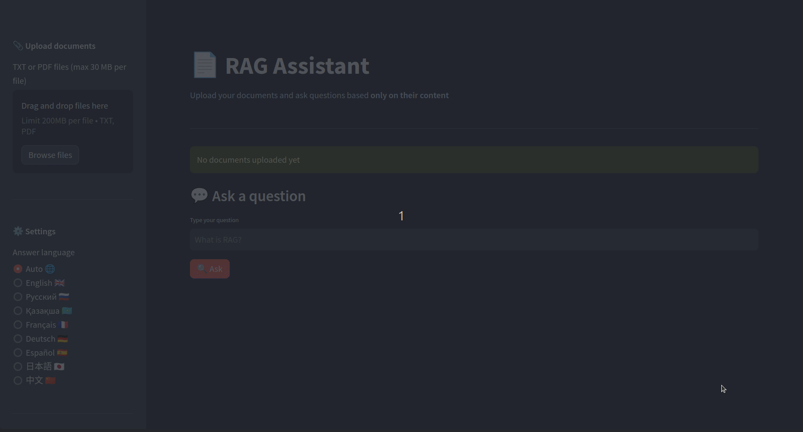
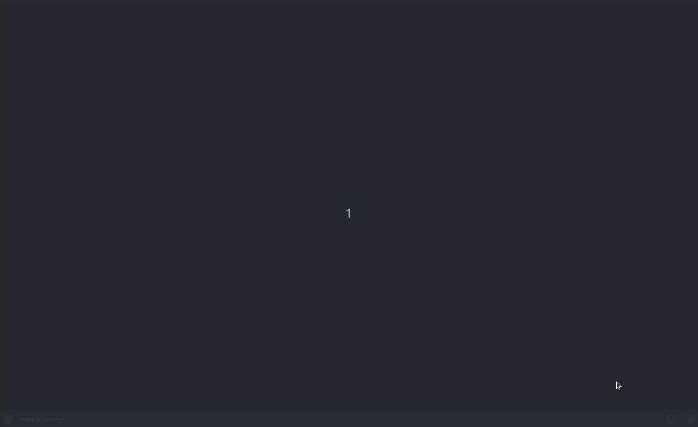

# 🤖 Multi-language RAG Document Assistant

A multi-language **Retrieval-Augmented Generation (RAG)** assistant for querying your own
documents with source attribution. FastAPI backend, Streamlit web UI, Telegram bot,
ChromaDB vector store plus a BM25 keyword index, OpenAI embeddings, and answers from
OpenAI or any OpenAI-compatible chat endpoint such as DeepSeek.

## Key Features

- **Multi-document Support**: PDF, DOCX, Markdown and plain text uploads. DOCX
  tables are read too, since that is where rates and dates usually sit (read
  [Known issues](#known-issues) before relying on them). Legacy text encodings
  (cp1251, koi8-r, ...) are detected automatically.
- **Table-aware Chunking**: a Markdown or HTML table in a text or Markdown file stays
  in one chunk when it fits; a longer one is split by rows with its header repeated on
  every piece, so a retrieved row keeps its column names (`TABLE_AWARE_CHUNKING`, on by
  default). Word and PDF tables, and Markdown tables of three or more columns with a
  spaced separator row (`| --- | --- | --- |`), are chunked as plain text for now (see
  KNOWN_ISSUES.md, section [Document ingestion](KNOWN_ISSUES.md#document-ingestion)).
- **Multilingual Intelligence**: Questions and answers in English, Russian, Kazakh,
  French, German, Spanish, Chinese, and Japanese - or `Auto` to mirror the question's
  language.
- **Hybrid Search**: answers draw on a ChromaDB vector search and a BM25 keyword search
  over the asker's own documents, merged by Reciprocal Rank Fusion, so exact names,
  numbers and rare terms are found as well as paraphrases (`HYBRID_SEARCH_ENABLED`, on
  by default). The keyword index lives in the backend's memory, and a question that
  triggers a metadata filter currently gets the vector search only (see KNOWN_ISSUES.md,
  section [Retrieval and search](KNOWN_ISSUES.md#retrieval-and-search)).
- **Metadata Filtering**: uploads are tagged with a company, year, quarter and document
  type guessed from the file name and opening text, and a question that names one - a
  year, `Q3`, `10-K`, a known company - is searched within the matching documents, or
  within all of the asker's documents when none match (`METADATA_FILTERING_ENABLED`, on
  by default). The web UI's Metadata Filter panel sets one by hand. The rules are built
  for financial filings: turn the setting off for a general document collection.
- **Optional Reranking**: a cross-encoder (FlashRank, run locally) or Cohere Rerank
  re-scores the retrieved candidates before the answer is written. Off by default: turn
  it on for the deployment (`RERANKER_ENABLED`, `RERANKER_PROVIDER`) or per question in
  the web UI's Cross-Encoder Reranker panel (`X-Reranker-*` headers in the API).
  FlashRank is not among the installed dependencies: install the `flashrank` package
  first, or results keep their original order.
- **Source Attribution**: Every answer is accompanied by a separate list of source
  filenames, with 200-character previews in the web UI and the API. Inline citation
  markers (`[1]`, `[2]`) are deliberately stripped from the answer text. The web UI
  also shows each source's metadata tags and, when reranking ran, its relevance score.
- **Streamed Answers**: The web UI shows the answer as it is written, rather
  than after the whole thing is generated.
- **Conversations**: Follow-up questions work - the assistant rewrites them
  into standalone questions before searching, so "and the second one?" finds
  the right passage. The Streamlit UI keeps the transcript on screen.
- **Content Deduplication**: Re-uploading the same bytes is a no-op, per owner.
- **Document Management**: List what is indexed and delete one document at a
  time. Re-uploading a file under the same name replaces the earlier revision
  rather than letting both answer questions.
- **Answers You Can Rate**: 👍/👎 under every answer in both clients. A rating
  carries the question, the answer, the documents behind it and the request id,
  so a complaint becomes a case the evaluation harness can measure instead of a
  story. `python -m evaluation.from_feedback` prints the down-rated questions
  (`--up` for the liked ones) as golden-case stubs for a person to complete.
- **Your Own Key and Model**: answer on your own API key with the model you name, from
  OpenAI, Anthropic, Gemini, DeepSeek or Kimi (Moonshot's `kimi` and `kimi-cn`
  endpoints), in either client. The backend never stores the key - it is used for one
  request and let go. Indexing stays on the deployment's key, because the vector store
  is bound to one embedding model.
- **Any OpenAI-compatible Chat Endpoint**: the deployment's own answers can come from a
  different endpoint than its embeddings: set `LLM_BASE_URL` and `LLM_API_KEY`, which
  otherwise fall back to `OPENAI_BASE_URL` and `OPENAI_API_KEY`. A DeepSeek URL such as
  `https://api.deepseek.com` switches the default model to `deepseek-flash`.
- **Bounded Growth**: per-owner limits on documents and bytes, shown in both clients
  before they are hit and refused loudly when they are. An idle-namespace sweep
  (`python -m scripts.sweep`) asks the running backend to remove the web UI's abandoned
  per-session namespaces, idle for 30 days by default (in Compose:
  `docker compose run --rm bot python -m scripts.sweep`);
  it is a dry run unless given `--apply`, and the backend refuses on its own where its
  activity data is most likely to be wrong.
- **Backup and Restore**: `python -m scripts.backup` writes one archive of the index, the
  uploads and the ratings, with a SHA-256 manifest; `python -m scripts.restore` checks an
  archive against it, refuses one that does not fit the deployment, and puts it back.
  Stop the backend first, and read [Known issues](#known-issues) before restoring into
  the Docker Compose volumes. The test suite does the full round trip, because a backup
  nobody has restored is a rumour.
- **Traceable Failures**: Every request carries an id, every log line records
  it, and it comes back in the `X-Request-ID` header - so a user reporting "it
  broke" hands over one string that finds their lines. `/ready` reports whether
  the backend can actually serve, which `/health` cannot answer.
- **Optional Langfuse Tracing**: with `LANGFUSE_ENABLED=true` and a Langfuse project's
  keys, each question becomes a trace keyed by its request id, with its retrieval,
  reranking and generation steps, and ratings arrive on it as scores. Traces carry the
  questions, the retrieved passages and the answers to `LANGFUSE_HOST` (Langfuse Cloud by
  default). `docker compose -f docker-compose.langfuse.yml up -d` runs Langfuse locally on
  `http://localhost:3000`, which is the `LANGFUSE_HOST` for a backend started on the host;
  a backend in a Compose container cannot reach it as `localhost`.
- **Evaluation and Benchmarks**: an offline retrieval-quality check runs with the test
  suite, and `python -m evaluation.run_eval` measures recall, precision and MRR on a
  golden set against a live backend. `python -m scripts.download_benchmarks` fetches
  FinanceBench, SberQuAD, HotpotQA, SciFact, TyDi QA and RAGTruth into `data/benchmarks/`
  (it takes no options, so even `--help` starts the download),
  `python -m scripts.upload_to_langfuse` turns them into Langfuse datasets, and
  `python -m evaluation.langfuse_eval` runs the golden set or a benchmark as a Langfuse
  experiment (see KNOWN_ISSUES.md, section
  [Evaluation and benchmarks](KNOWN_ISSUES.md#evaluation-and-benchmarks)).
- **Multiple Interfaces**:
  - **FastAPI Backend**: REST API guarded by a shared-secret header.
  - **Streamlit Web UI**: Responsive desktop/mobile interface. Each browser session
    gets its own document space, so a page reload starts with no documents.
  - **Telegram Bot**: Query your documents on the go.
- **Dockerized**: Separate development and production Compose configurations.

## Architecture Overview

- **Frontend**: Streamlit application for web-based interaction (`frontend/streamlit_app.py`).
- **Bot**: Telegram bot built on `python-telegram-bot` (`clients/telegram_bot.py`).
  Both clients share `clients/backend.py`.
- **Backend**: FastAPI server (`app/main.py`) orchestrating the RAG pipeline.
- **RAG Core** (`app/rag/`): document loading, table-aware chunking, metadata tagging,
  hybrid retrieval (ChromaDB vectors plus an in-memory BM25 index, fused by RRF),
  optional reranking, and answer generation through the OpenAI SDK. LangChain
  (`langchain`, `langchain-community`, `langchain-chroma`) supplies the PDF loader, the
  text splitter and the Chroma wrapper, with a custom OpenAI embedding function.
- **Storage**: ChromaDB for vector embeddings (`CHROMA_PERSIST_DIR`), the local
  filesystem for raw uploads and the sweep's activity markers (`UPLOAD_DIR`) and for the
  ratings log (`FEEDBACK_DIR`). The BM25 index exists only in the backend's memory.
- **Tracing**: an optional Langfuse client (`app/tracing.py`) that does nothing unless
  enabled.

## Quick Start

1. **Clone & configure**:
   ```bash
   git clone https://github.com/Modern-Messiah/Multi-language-RAG-Document-Assistant.git
   cd Multi-language-RAG-Document-Assistant
   cp .env.template .env
   ```
   Then edit `.env`:
   - `OPENAI_API_KEY` - required: embeddings always use it, and the backend refuses to
     start without it. The template's placeholder lets it start, but every upload then
     fails with "Vector store unavailable".
   - `BACKEND_API_KEY` - the shared secret every client sends as `X-API-Key`.
     Replace the placeholder with a long random ASCII string. Leaving it **empty**
     disables authentication entirely (development only; a warning is logged).
   - `TELEGRAM_BOT_TOKEN` - required only if you run the bot service.
   - Optional: `LLM_BASE_URL` and `LLM_API_KEY` to take answers from another
     OpenAI-compatible endpoint, such as DeepSeek. Every other setting is listed in
     `.env.template` and in the [Configuration](DOCUMENTATION.md#configuration) table.

2. **Run with Docker**:
   ```bash
   # Development: bind-mounts your working tree and runs the API with --reload
   docker compose up --build

   # Production: code baked into the image, no reload, detached
   docker compose -f docker-compose.yml up -d --build
   ```
   `docker compose up` auto-merges `docker-compose.override.yml`, so the plain command is
   always the *development* configuration. Pass `-f docker-compose.yml` explicitly to run
   the production shape.

   Without a valid `TELEGRAM_BOT_TOKEN` the `bot` container exits and restarts in a loop.
   Start just the web stack instead: `docker compose up backend frontend`.

3. **Access the services**:
   - **Frontend**: `http://localhost:8501` - published on all interfaces, with no
     login of its own while it holds the shared secret. On an untrusted network,
     put it behind an authenticating reverse proxy.
   - **API Docs**: `http://localhost:8000/docs` - served without authentication and
     published on the **loopback interface only**; the frontend and bot reach the API
     over the internal `rag_net` network.

4. **Telegram Bot**:
   - Send `/start` and pick an answer language.
   - Attach a PDF, DOCX, Markdown or TXT file to index it.
   - Send any plain text message to ask a question about your documents.
   - `/documents` lists what is indexed, `/clear` deletes all of it,
     `/help` shows usage.
   - `/model <model> <your api key>` or `/model <provider> <model> <your api key>`
     answers on your own account - `openai` (the default), `anthropic`, `gemini`,
     `deepseek`, `kimi` or `kimi-cn`. `/model` alone shows the current setting and
     `/model reset` goes back to the assistant's own. The key is never written to
     disk: the bot holds it in memory until `/model reset` or a restart, and deletes
     the message that carried it (or tells you to, when it cannot).

## Run without Docker

Use Python 3.10, the version the Docker image and CI run:

```bash
python3.10 -m venv .venv && . .venv/bin/activate   # Linux / macOS
pip install -r requirements.txt

uvicorn app.main:app --reload --port 8000      # backend
streamlit run frontend/streamlit_app.py        # web UI
python -m clients.telegram_bot                 # bot
```

Create `.env` first (step 1 of the Quick Start), then start each service in its own
terminal with the venv active, all from the repository root: the backend reads `.env`
from the current directory, and the clients find the same file. The web UI is then on
`http://localhost:8501` (Streamlit listens on all interfaces by default, as in Docker)
and the API docs on `http://localhost:8000/docs` (uvicorn's default, loopback only).

**Windows**: with [uv](https://docs.astral.sh/uv/), which also fetches Python 3.10 if
needed:

```powershell
uv venv --python 3.10 .venv
.venv\Scripts\activate
uv pip install -r requirements.txt -r requirements-dev.txt
```

From WSL, call that venv as `.venv/Scripts/python.exe -m <module>` from the repository
root (Linux environment variables reach it only when listed in `WSLENV`). Where Windows
application control (Device Guard / WDAC) blocks that interpreter, use a Linux venv in
WSL instead: `uv venv --python 3.10 ~/.venvs/<name>`, then
`uv pip install --python ~/.venvs/<name>/bin/python --require-hashes -r requirements-dev.lock`
(exactly CI's set), and run it from the checkout.

## Development

```bash
pip install -r requirements.txt -r requirements-dev.txt
ruff check app frontend clients evaluation scripts tests
pytest -q
```

On Linux with Python 3.10, `pip install --require-hashes -r requirements-dev.lock`
installs exactly the set CI tests with.

Dependencies are declared in `requirements*.txt` and resolved into
`requirements*.lock` (every transitive package pinned and hashed), which is what
the Docker image and CI install. The locks are resolved for linux / CPython 3.10,
so install from the `requirements*.txt` files on a Windows or macOS machine. See
[DOCUMENTATION.md](DOCUMENTATION.md#dependencies-and-the-lock-files) for how to
regenerate them.

The test suite runs **fully offline** - embeddings are replaced with deterministic local
vectors, the OpenAI chat client is injected and outbound connections are blocked, so no
test makes a network call. No API key is needed: `tests/conftest.py` sets a dummy
`OPENAI_API_KEY` itself, replacing any real one you exported. Run the suite from the
repository root, and move a local `.env` aside first: the web UI and bot tests load it,
which can change their results (see KNOWN_ISSUES.md, section
[Development and tests](KNOWN_ISSUES.md#development-and-tests)).

Before and after a retrieval or chunking change, measure it against a live backend
with `python -m evaluation.run_eval --url http://127.0.0.1:8000 --api-key <BACKEND_API_KEY>`
(real embedding and chat calls, so it never runs in CI). See
[Measuring retrieval](DOCUMENTATION.md#measuring-retrieval).


**Demonstration of work**:






## Working with AI coding agents

[CLAUDE.md](CLAUDE.md) is the entry point for coding agents such as Claude Code: setup
and commands per OS, the invariants every change must keep, and the doc-drift tests.
Task-specific knowledge lives in project skills under `.claude/skills/`. Claude Code
discovers them at the start of a session and loads one when a task matches its
description; `/rag-testing` and the like invoke a skill by name.
`tests/test_agent_docs.py` checks the links, paths and commands in CLAUDE.md,
KNOWN_ISSUES.md and the skills against the repository.

| Skill | Use it for |
| --- | --- |
| [rag-architecture](.claude/skills/rag-architecture/SKILL.md) | how the pieces fit together and where to change what |
| [rag-development-guide](.claude/skills/rag-development-guide/SKILL.md) | setup per OS, running services, lint, dependencies and locks, CI, commits |
| [rag-testing](.claude/skills/rag-testing/SKILL.md) | the offline test suite, its fixtures and what to run |
| [rag-config-and-docs](.claude/skills/rag-config-and-docs/SKILL.md) | adding a setting and keeping the docs in step with the code |
| [rag-api-endpoints](.claude/skills/rag-api-endpoints/SKILL.md) | routes, auth, status codes and streaming |
| [rag-retrieval-pipeline](.claude/skills/rag-retrieval-pipeline/SKILL.md) | hybrid search, metadata filters, reranking, prompts and languages |
| [rag-document-ingestion](.claude/skills/rag-document-ingestion/SKILL.md) | file formats, chunking, tables, metadata tags and the rules that turn questions into filters |
| [rag-llm-providers](.claude/skills/rag-llm-providers/SKILL.md) | the server's LLM endpoint, own-key providers and models |
| [rag-clients](.claude/skills/rag-clients/SKILL.md) | the web UI and the Telegram bot |
| [rag-operations](.claude/skills/rag-operations/SKILL.md) | backup, restore, sweep, logs and Langfuse |
| [rag-evaluation](.claude/skills/rag-evaluation/SKILL.md) | retrieval metrics, the golden set and benchmarks |
| [rag-change-review](.claude/skills/rag-change-review/SKILL.md) | the project checklist for reviewing a change |

## Known issues

Verified defects and their workarounds are collected in [KNOWN_ISSUES.md](KNOWN_ISSUES.md).
The ones you are most likely to meet:

- After `python -m scripts.sweep --apply`, restart the backend: the swept documents stay in
  its in-memory keyword index and can still be cited for the same user id. Run on the
  host, `scripts.backup` and `scripts.restore` ignore `.env`, so export its variables
  first. Restoring into the Docker Compose volumes fails, and with `--overwrite` it
  empties the index volume first, so keep the archive. See KNOWN_ISSUES.md, section
  [Operations: backup, restore and sweep](KNOWN_ISSUES.md#operations-backup-restore-and-sweep).
- Word tables: a cell that repeats the text before it and every empty cell are dropped,
  so values can land under the wrong column, and the tables are moved to the end of the
  document text. Upload tables that matter as Markdown with a compact `|---|---|`
  separator row. See KNOWN_ISSUES.md, section
  [Document ingestion](KNOWN_ISSUES.md#document-ingestion).
- Automatic metadata filtering treats any number from 1900 to 2039 and words such as
  "block", "square" or "meta" as filters, which can hide the right document in a general
  collection; set `METADATA_FILTERING_ENABLED=false` there. See KNOWN_ISSUES.md, section
  [Retrieval and search](KNOWN_ISSUES.md#retrieval-and-search).
- Any API-key holder can turn reranking on per request, even with `RERANKER_ENABLED=false`,
  and a Cohere request without its own key spends the operator's `RERANKER_API_KEY`, so
  leave that key empty unless all of them may use it. See KNOWN_ISSUES.md, section
  [Models, keys and reranking](KNOWN_ISSUES.md#models-keys-and-reranking).
- Web UI: after an answer is cut short before any text appears, or comes back empty,
  every later question in that browser session fails with "String should have at least
  1 character" until "Clear all documents" or a page reload, both of which leave you with
  no documents. In the key panel, pick the provider before typing the model: switching
  the provider clears the Model box. See KNOWN_ISSUES.md, section [Web UI](KNOWN_ISSUES.md#web-ui).
- Telegram bot: `/model <your api key>` without a model name is refused, and the message
  with your key is not deleted; with the key and model swapped, the bot repeats the key in
  its reply. Delete such messages yourself and use `/model <model> <your api key>`. After
  an empty answer, every later question fails the same way until `/start`. See
  KNOWN_ISSUES.md, section [Telegram bot](KNOWN_ISSUES.md#telegram-bot).
- Possible risk, not yet confirmed: on a fresh Docker deployment, ratings may fail with
  "Feedback storage unavailable", because the image does not create `data/feedback` for
  its volume. The one-line ownership fix is in KNOWN_ISSUES.md, section
  [Operations: backup, restore and sweep](KNOWN_ISSUES.md#operations-backup-restore-and-sweep).

## Documentation

[DOCUMENTATION.md](DOCUMENTATION.md) is the developer and operator reference:

- **Setting up**: [installation](DOCUMENTATION.md#installation--setup),
  [dependencies and the lock files](DOCUMENTATION.md#dependencies-and-the-lock-files),
  [Docker deployment](DOCUMENTATION.md#docker-deployment),
  [configuration](DOCUMENTATION.md#configuration).
- **Using it**: [API reference](DOCUMENTATION.md#api-reference),
  [your own key and model](DOCUMENTATION.md#your-own-key-and-model),
  [tenant separation](DOCUMENTATION.md#tenant-separation-and-the-trust-model).
- **Retrieval**: [hybrid search](DOCUMENTATION.md#hybrid-search-dense--bm25),
  [metadata filtering](DOCUMENTATION.md#metadata-filtering),
  [reranking](DOCUMENTATION.md#reranking),
  [table-aware chunking](DOCUMENTATION.md#table-aware-chunking),
  [measuring retrieval](DOCUMENTATION.md#measuring-retrieval).
- **Operating**: [quotas and retention](DOCUMENTATION.md#quotas-and-retention),
  [backup and restore](DOCUMENTATION.md#backup-and-restore),
  [answer feedback](DOCUMENTATION.md#answer-feedback),
  [observability](DOCUMENTATION.md#observability),
  [tracing with Langfuse](DOCUMENTATION.md#tracing-with-langfuse),
  [benchmarks and Langfuse experiments](DOCUMENTATION.md#benchmarks-and-langfuse-experiments).
- **Limits**: [known issues](DOCUMENTATION.md#known-issues), in full in
  [KNOWN_ISSUES.md](KNOWN_ISSUES.md).

Licensed under the MIT License, see [LICENSE](LICENSE).
